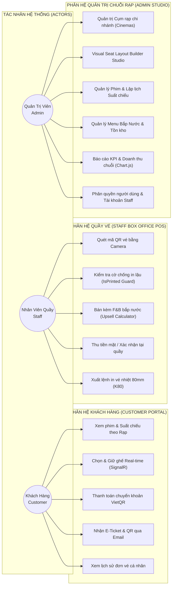

# BỐI CẢNH DỰ ÁN VÀ PHÂN QUYỀN TRUY CẬP (PROJECT CONTEXT & RBAC)
## HỆ THỐNG QUẢN TRỊ TẬP TRUNG CHUỖI RẠP CHIẾU PHIM (CINEMANAGEMENT)

> **Tài liệu đặc tả**: `00-project-context.md`  
> **Quy trình áp dụng**: Spec-Driven Development (SDD) & Spec-Kit Governance  
> **Phiên bản kiến trúc**: v2.0 - Cinema Chain Enterprise Edition  
> **Mục tiêu sư phạm**: Chuẩn đầu ra CLO1 (Phân tích & Thiết kế kiến trúc) / CLO2 (Hiện thực hóa & Kiểm thử hệ thống)

---

## 1. LÝ DO CHỌN ĐỀ TÀI & TẦM NHÌN SẢN PHẨM

### 1.1. Bối cảnh chuyển dịch mô hình vận hành
Trong thời đại chuyển đổi số ngành giải trí, mô hình **Rạp chiếu phim đơn lẻ (Single Cinema)** đã hoàn toàn bộc lộ các giới hạn về năng lực quản lý, chi phí vận hành và trải nghiệm khách hàng. Sự phát triển mạnh mẽ của các chuỗi rạp chiếu phim hiện đại (như CGV, Lotte Cinema, Beta Cinemas) đòi hỏi một **Hệ thống Quản trị Tập trung cho Toàn Chuỗi Rạp (Centralized Multiplex Cinema Chain Management System)**.

Hệ thống **CineManagement** được thiết kế nhằm đáp ứng mô hình chuỗi đa chi nhánh (`Cinemas`), cho phép quản lý tập trung từ xa danh mục phim, lịch chiếu, giá vé, kiểm soát tồn kho F&B, sơ đồ phòng chiếu đa định dạng (2D, 3D, IMAX, VIP, Sweetbox) và hợp nhất toàn bộ báo cáo doanh thu theo thời gian thực.

### 1.2. Ba bài toán kỹ thuật cốt lõi (Core Technical Problems)
Để đáp ứng tiêu chuẩn phần mềm quy mô chuỗi rạp, hệ thống giải quyết triệt để 3 thách thức kỹ thuật sau:

1. **Xử lý tranh chấp tương tranh cao & Đồng bộ ghế thời gian thực (< 50ms)**:
   * *Thách thức*: Khi mở bán các suất chiếu bom tấn giờ cao điểm, hàng trăm khách hàng cùng truy cập và nhấp chọn cùng một vị trí ghế trong cùng một phần nghìn giây (Race Condition).
   * *Giải pháp*: Kết hợp mô hình **Dual-Concurrency Engine** (Khóa bi quan `IsolationLevel.Serializable` ở tầng Transaction DB + Khóa lạc quan `[ConcurrencyCheck] public int Version` trên từng ghế `ShowtimeSeat`) cùng cổng **SignalR WebSockets Hub (`SeatBookingHub`)** để phát sóng trạng thái ghế tức thì cho mọi client trong nhóm suất chiếu.
2. **Đảm bảo độ tin cậy giao dịch tuyệt đối & Chống mất Email vé (Transactional Outbox Pattern)**:
   * *Thách thức*: Khách hàng thanh toán qua cổng điện tử thành công nhưng nếu máy chủ gửi email gặp sự cố mạng (timeout, lỗi SMTP 503), việc rollback giao dịch là không thể (khách đã mất tiền), còn nếu không gửi được email vé thì khách không có mã QR vào rạp.
   * *Giải pháp*: Áp dụng mẫu thiết kế **Transactional Outbox Pattern**. Toàn bộ dữ liệu đặt vé và bản ghi sự kiện `TicketEmail` được lưu trữ nguyên tử ($ACID$) trong cùng một Database Transaction vào bảng `outboxmessages`. Một Background Worker (`OutboxMessageWorker`) định kỳ quét, chuyển phát thư qua SMTP Gmail với cơ chế Exponential Backoff & Retry (tối đa 3 lần), bảo đảm nguyên lý *At-Least-Once Delivery*.
3. **Tối ưu hóa quy trình Quầy vé POS "Một Cửa" (Box Office Counter POS)**:
   * *Thách thức*: Ùn tắc tại sảnh rạp trước giờ chiếu do khách hàng mang mã QR trên điện thoại đến đổi vé cứng, quy trình bán kèm bắp nước (Upsell F&B) bị tách rời làm chậm thời gian phục vụ, và nguy cơ gian lận vé (dùng một mã QR in vé nhiều lần).
   * *Giải pháp*: Xây dựng giao diện POS một chạm chuyên biệt (`/Counter`): Camera quét QR trực tiếp (`html5-qrcode`), cờ kiểm soát chống in lậu (`IsPrinted Guard`), công cụ gợi ý bán thêm combo F&B nhanh và tự động xuất lệnh in vé nhiệt chuẩn khổ 80mm (K80) theo giao thức ESC/POS.

---

## 2. PHÂN QUYỀN TRUY CẬP VAI TRÒ (RBAC - ROLE-BASED ACCESS CONTROL)

Hệ thống được bảo mật và phân quyền nghiêm ngặt dựa trên mô hình **Role-Based Access Control (RBAC)** của ASP.NET Core Identity, phân định rõ ranh giới trách nhiệm cho 3 nhóm tác nhân (Actors):

```
┌─────────────────────────────────────────────────────────────────────────────────┐
│                               DANH MỤC 3 ACTORS                                 │
├────────────────────┬────────────────────────────────────────────────────────────┤
│ 1. Customer        │ Người dùng cuối đặt vé trực tuyến qua Web Portal           │
│ 2. Staff           │ Nhân viên thu ngân tại rạp, chỉ sử dụng cổng POS Quầy vé   │
│ 3. Admin           │ Quản trị viên hệ thống, toàn quyền vận hành chuỗi rạp      │
└────────────────────┴────────────────────────────────────────────────────────────┘
```

### 2.1. Khách Hàng (Customer)
* **Phạm vi truy cập**: Cổng thông tin khách hàng trực tuyến (Public Web Portal).
* **Quyền hạn nghiệp vụ**:
  * Đăng ký, đăng nhập tài khoản, quản lý thông tin cá nhân và lịch sử đặt vé.
  * Xem danh sách phim đang chiếu, sắp chiếu, phân loại theo cụm rạp chi nhánh (`Cinemas`).
  * Xem chi tiết phim, thời lượng, trailer, giới hạn độ tuổi (`AgeRating: P, C13, C16, C18`).
  * Chọn suất chiếu và hiển thị ma trận sơ đồ ghế 2D CSS Grid thời gian thực.
  * Giữ ghế trực tuyến (thời hạn 5 phút), thanh toán chuyển khoản qua mã VietQR tự động.
  * Nhận vé điện tử E-Ticket kèm mã QR qua hộp thư Email cá nhân.

### 2.2. Nhân Viên Quầy (Staff)
* **Phạm vi truy cập**: Giới hạn nghiêm ngặt tại phân hệ Quầy vé POS (`/Counter`). Nhân viên **hoàn toàn bị chặn (Forbidden 403)** khi cố tình truy cập vào các phân hệ Quản trị Admin.
* **Quyền hạn nghiệp vụ**:
  * Sử dụng Camera quét mã QR vé từ điện thoại khách hàng hoặc tra cứu mã đơn đặt vé (`BookingCode`).
  * **Cơ chế IsPrinted Guard**: Kiểm tra trạng thái vé. Nếu vé đã được in trước đó (`IsPrinted == true`), hệ thống khóa lệnh và báo động phát hiện gian lận.
  * Tư vấn và bán kèm các sản phẩm bắp nước (Upsell F&B) vào đơn vé hiện tại.
  * Tiếp nhận thanh toán tiền mặt (Cash) hoặc chuyển khoản tại quầy.
  * Kích hoạt lệnh in cuộn vé nhiệt 80mm K80 (nhả cuống vé cho từng ghế và phiếu nhận F&B rời).

### 2.3. Quản Trị Viên Chuỗi Rạp (Admin)
* **Phạm vi truy cập**: Toàn quyền trên toàn bộ các phân hệ quản trị hệ thống (`/Admin`, `/ScreeningRoom`, `/Movie`, `/Showtime`, `/User`).
* **Quyền hạn nghiệp vụ**:
  * Quản trị mạng lưới Cụm rạp chi nhánh (`Cinemas`): Thêm rạp mới, địa chỉ, số hotline, cấu hình phòng chiếu.
  * **Visual Seat Layout Builder Studio**: Thiết kế ma trận phòng chiếu 2D, tùy biến số hàng/cột, thiết lập các hành lang dọc/ngang (Aisles), cọ vẽ hạng ghế (Thường, VIP, Sweetbox) với cơ chế Aisle Guard ngăn ghế đôi lấn sang hành lang.
  * Quản lý danh mục phim (`Catalog`), cập nhật quốc gia, định dạng chiếu (2D, 3D, IMAX), phụ đề/lồng tiếng.
  * Lập lịch suất chiếu (`Showtime Scheduling`) linh hoạt, tự động sinh ma trận `ShowtimeSeats` tương ứng với sơ đồ vật lý của phòng chiếu.
  * Báo cáo tổng hợp KPI: Doanh thu theo chuỗi rạp, theo phim, tỷ lệ lấp đầy phòng chiếu (Occupancy Rate) thông qua biểu đồ trực quan.
  * Quản trị tài khoản người dùng, tạo tài khoản và phân quyền cho nhân viên rạp (`Staff`).

---

## 3. BIỂU ĐỒ USE CASE HỆ THỐNG (SYSTEM USE CASE DIAGRAM)



---

## 4. SƠ ĐỒ PHÂN RÃ CHỨC NĂNG (FUNCTION DECOMPOSITION DIAGRAM - FDD)

```mermaid
graph TD
    Root["HỆ THỐNG QUẢN LÝ CHUỖI RẠP CHIẾU PHIM (CINEMANAGEMENT)"]

    %% Cấp 1
    M1["1.0 Quản Lý Cụm Rạp & Sơ Đồ Ghế"]
    M2["2.0 Quản Lý Phim & Lịch Chiếu"]
    M3["3.0 Đặt Vé & Đồng Bộ Ghế Real-time"]
    M4["4.0 Vận Hành Quầy Vé Box Office POS"]
    M5["5.0 Quản Trị Hệ Thống & Báo Cáo KPI"]

    Root --> M1
    Root --> M2
    Root --> M3
    Root --> M4
    Root --> M5

    %% Cấp 2 - Module 1
    M1 --> M1_1["1.1 CRUD Cụm rạp chi nhánh (Cinemas)"]
    M1 --> M1_2["1.2 Quản lý Phòng chiếu (Screening Rooms)"]
    M1 --> M1_3["1.3 Visual Seat Layout Builder Studio"]
    M1_3 --> M1_3_1["1.3.1 Cấu hình Lối đi đa hành lang"]
    M1_3_2["1.3.2 Cọ vẽ Ghế đôi chống tràn (Aisle Guard)"]
    M1_3 --> M1_3_2
    M1_3 --> M1_3_3["1.3.3 Tự động đánh nhãn hàng/cột (Auto-index)"]

    %% Cấp 2 - Module 2
    M2 --> M2_1["2.1 Quản lý Phim & Metadata (Poster, Trailer, Độ tuổi)"]
    M2 --> M2_2["2.2 Lập lịch suất chiếu thông minh (Tránh trùng phòng)"]
    M2 --> M2_3["2.3 Tự động sinh ma trận ghế suất chiếu (ShowtimeSeats)"]

    %% Cấp 2 - Module 3
    M3 --> M3_1["3.1 Giữ ghế thời gian thực (SignalR WebSockets)"]
    M3 --> M3_2["3.2 Kiểm soát tương tranh lạc quan (Version Token)"]
    M3 --> M3_3["3.3 Tự động nhả ghế quá hạn 5 phút (Background Worker)"]
    M3 --> M3_4["3.4 Thanh toán VietQR & Transactional Outbox Pattern"]
    M3 --> M3_5["3.5 Chuyển phát E-Ticket kèm QR Code qua Email"]

    %% Cấp 2 - Module 4
    M4 --> M4_1["4.1 Quét QR Code vé bằng Camera thiết bị"]
    M4 --> M4_2["4.2 Kiểm tra & Khóa cờ chống in lậu (IsPrinted Guard)"]
    M4 --> M4_3["4.3 Máy tính bán kèm bắp nước nhanh (F&B Upsell)"]
    M4 --> M4_4["4.4 Thanh toán quầy & In cuộn vé nhiệt 80mm (K80)"]

    %% Cấp 2 - Module 5
    M5 --> M5_1["5.1 Dashboard Doanh thu chuỗi rạp thời gian thực"]
    M5 --> M5_2["5.2 Thống kê Tỷ lệ lấp đầy & Top phim ăn khách"]
    M5 --> M5_3["5.3 Quản lý Người dùng & Phân quyền RBAC"]
```



---

## 5. MA TRẬN PHÂN QUYỀN TRUY CẬP (ACCESS PERMISSION MATRIX)

| Phân hệ / Endpoint | Khách hàng (Customer) | Nhân viên quầy (Staff) | Quản trị viên (Admin) |
| :--- | :---: | :---: | :---: |
| **Xem danh sách phim & lịch chiếu** | ✅ Đọc | ✅ Đọc | ✅ Đọc |
| **Đặt ghế & Thanh toán online** | ✅ Tạo đơn | ❌ Từ chối | ✅ Toàn quyền |
| **Quầy vé Box Office POS (`/Counter/*`)** | ❌ Cấm (403) | ✅ Toàn quyền | ✅ Toàn quyền |
| **Quét mã QR soát vé & In nhiệt K80** | ❌ Cấm (403) | ✅ Thực hiện | ✅ Thực hiện |
| **Bán Upsell Bắp Nước tại quầy** | ❌ Cấm (403) | ✅ Thực hiện | ✅ Thực hiện |
| **Visual Seat Layout Studio (`/ScreeningRoom/*`)** | ❌ Cấm (403) | ❌ Cấm (403) | ✅ Toàn quyền |
| **Quản trị Cụm rạp & Lập lịch suất chiếu** | ❌ Cấm (403) | ❌ Cấm (403) | ✅ Toàn quyền |
| **Báo cáo doanh thu & Phân quyền User** | ❌ Cấm (403) | ❌ Cấm (403) | ✅ Toàn quyền |
