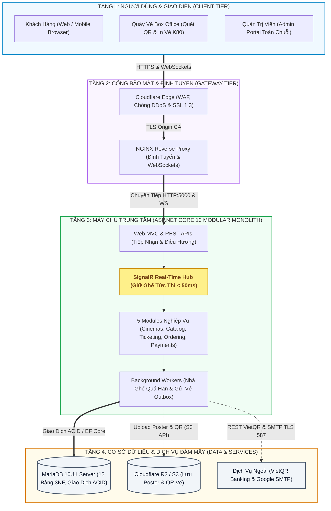
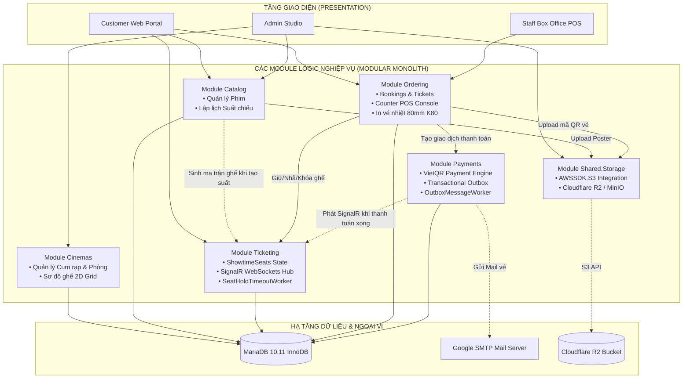
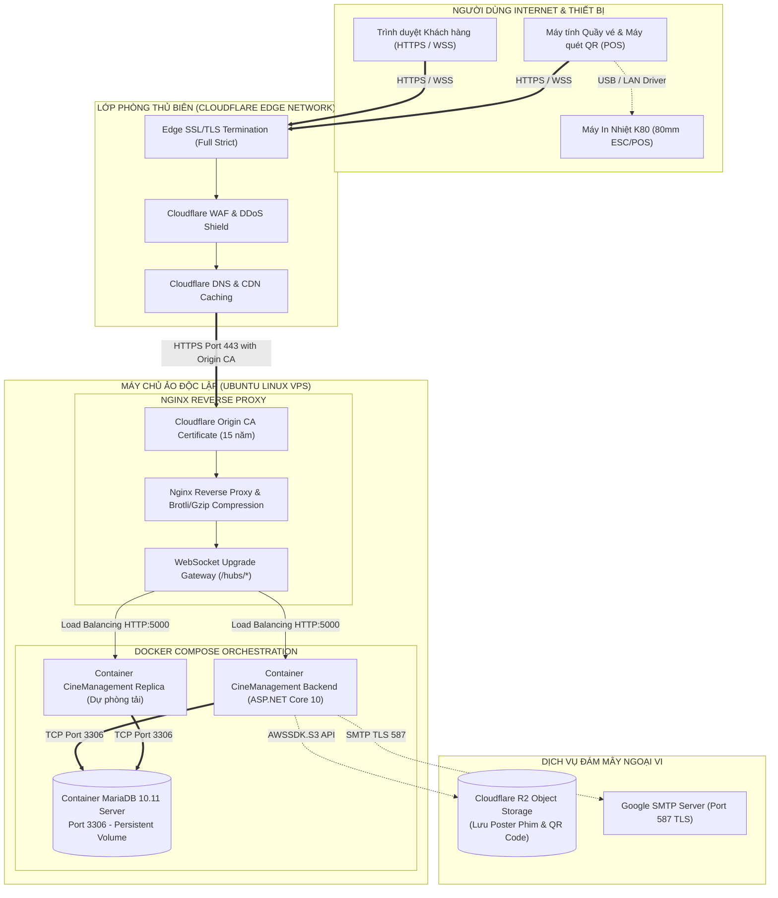

# THIẾT KẾ KIẾN TRÚC MODULAR MONOLITH & TRIỂN KHAI HỆ THỐNG
## HỆ THỐNG QUẢN TRỊ TẬP TRUNG CHUỖI RẠP CHIẾU PHIM (CINEMANAGEMENT)

> **Tài liệu đặc tả**: `01-architecture.md`  
> **Mục tiêu đáp ứng**: Chuẩn đầu ra **CLO1** (Khả năng phân tích, mô hình hóa và thiết kế kiến trúc hệ thống phần mềm doanh nghiệp)  
> **Phong cách kiến trúc**: Modular Monolith Architecture  
> **Công nghệ nền tảng**: ASP.NET Core 10, C# 13, EF Core 10, SignalR Core, Cloudflare R2 / MinIO S3

---

## 1. TỔNG QUAN KIẾN TRÚC MODULAR MONOLITH

Thay vì áp dụng kiến trúc Microservices phân tán sớm (gây ra độ trễ mạng, phân mảnh transaction phức tạp và chi phí hạ tầng tốn kém) hoặc kiến trúc Traditional Monolith nguyên khối hỗn loạn (gây thắt nút cổ chai và phụ thuộc vòng vèo), **CineManagement** áp dụng kiến trúc **Modular Monolith**.

Kiến trúc này đóng gói ứng dụng trong một đơn vị triển khai duy nhất (Single Deployment Unit) nhưng phân chia mã nguồn bên trong thành các **Mô-đun độc lập (Bounded Contexts)** có ranh giới nghiệp vụ rõ ràng, giao tiếp nội bộ thông qua In-process Method Calls, DTOs và Domain Events.

---

## 2. ĐẶC TẢ CHI TIẾT CÁC MÔ-ĐUN NGHIỆP VỤ (MODULE BOUNDARIES)

### 2.1. Module `Cinemas` (Quản trị Cụm rạp & Phòng chiếu)
* **Trách nhiệm cốt lõi**:
  * Quản lý thực thể Cụm rạp chi nhánh (`Cinemas`): Mã rạp (`CS-QT`, `CS-HBT`), Tên, Địa chỉ, Số hotline.
  * Quản lý Phòng chiếu (`ScreeningRooms`): Định dạng phòng (2D Standard, 3D, IMAX Laser), tổng số hàng, tổng số cột.
  * **Visual Seat Layout Studio**: Quản lý các ghế vật lý (`Seats`), phân loại hạng ghế (`SeatTypes`), tọa độ ma trận (`GridRow`, `GridCol`), độ rộng ghế (`ColSpan = 1` hoặc `2`).
  * Thực thi quy tắc **Aisle Guard**: Ngăn chặn cấu hình ghế đôi Sweetbox lấn sang cột hành lang hoặc vượt biên phòng chiếu.

### 2.2. Module `Catalog` (Danh mục Phim & Lập lịch Suất chiếu)
* **Trách nhiệm cốt lõi**:
  * Quản lý thông tin Phim (`Movies`): Tên phim, thời lượng, đạo diễn, diễn viên, quốc gia (`Country`), định dạng (`Format`), phụ đề/lồng tiếng (`SubtitleType`), giới hạn độ tuổi (`AgeRating: P, K, T13, T16, T18, C`).
  * Quản lý Suất chiếu (`Showtimes`): Lập lịch chiếu phim theo phòng và khung giờ; thuật toán kiểm tra xung đột thời gian chiếu (ngăn 2 phim chiếu trùng một phòng cùng khung giờ).
  * Kích hoạt sự kiện sinh ma trận ghế suất chiếu tự động khi một suất chiếu mới được tạo.

### 2.3. Module `Ticketing` (Điều phối Ghế Suất chiếu & Real-time WebSockets)
* **Trách nhiệm cốt lõi**:
  * Quản lý bảng trạng thái biến thiên `ShowtimeSeats`: Trạng thái ghế (`Available = 0, Held = 1, Reserved = 2`), ID người giữ (`HeldByUserId`), thời điểm hết hạn giữ (`HoldExpiresAt`), mã phiên bản kiểm soát tương tranh (`Version`).
  * **SignalR WebSocket Gateway (`SeatBookingHub`)**:
    * Phân nhóm kết nối theo từng suất chiếu (`showtime_{id}`).
    * Phát sóng sự kiện `SeatStatusChanged` tức thì (< 50ms) cho mọi client trong nhóm khi có ghế bị giữ, nhả hoặc đã thanh toán.
  * **Background Worker (`SeatHoldTimeoutWorker`)**: Định kỳ quét mỗi 30 giây để thu hồi các ghế `Held` đã quá hạn 5 phút, trả về `Available` và bắn thông báo SignalR giải phóng ghế.

### 2.4. Module `Ordering` (Quản lý Đặt vé, Bắp nước & Quầy vé Box Office POS)
* **Trách nhiệm cốt lõi**:
  * Quản lý đơn hàng đặt vé trực tuyến (`Bookings`) và các vé xem phim thành phần (`Tickets`).
  * Quản lý bán kèm Bắp nước F&B (`BookingConcessions` và `FoodItems`).
  * **Box Office POS Engine (`/Counter`)**:
    * Phân tích mã QR từ camera nhân viên (`html5-qrcode`).
    * **Kiểm tra IsPrinted Guard**: Kiểm tra cờ `IsPrinted`. Nếu vé đã in cứng trước đó, chặn đứng hành vi in lại để ngăn gian lận.
    * Gợi ý Upsell bắp nước và cộng dồn hóa đơn tại quầy.
    * Xuất lệnh in phiếu nhiệt chuẩn 80mm K80 (ESC/POS) cho từng ghế và phiếu nhận combo bắp nước riêng biệt.

### 2.5. Module `Payments` (Thanh toán & Transactional Outbox)
* **Trách nhiệm cốt lõi**:
  * Tích hợp thanh toán trực tuyến tự động qua chuẩn **VietQR Napas 247** (tạo mã QR động kèm số tiền và nội dung chuyển khoản theo cú pháp đơn hàng).
  * Xử lý xác nhận thanh toán (`ConfirmPaymentAsync`) dưới cơ chế `IsolationLevel.Serializable`.
  * **Transactional Outbox Engine**:
    * Lưu bản ghi sự kiện `TicketEmail` vào bảng `outboxmessages` trong cùng một Local Transaction của đơn hàng ($ACID$).
    * **OutboxMessageWorker**: Tiến trình nền chạy độc lập mỗi 5 giây, quét các message chưa xử lý, kết nối Google SMTP gửi email E-Ticket kèm mã QR cá nhân hóa với cơ chế Retry tối đa 3 lần.

### 2.6. Module `Shared.Storage` (Lưu trữ Đám mây Cloudflare R2 / MinIO S3)
* **Trách nhiệm cốt lõi**:
  * Thay thế việc lưu trữ file trực tiếp trên ổ cứng web server (`wwwroot/uploads`), giúp hệ thống có thể mở rộng nhiều container mà không bị mất file.
  * Sử dụng thư viện chuẩn **`AWSSDK.S3`** giao tiếp qua giao thức S3-compatible API:
    * Môi trường Production: Kết nối **Cloudflare R2 Storage** (Zero Egress Fees, CDN toàn cầu siêu tốc).
    * Môi trường Development/Local: Kết nối cụm **MinIO S3** container hóa.
  * Lưu trữ và phân phối Poster phim độ phân giải cao, Banner sự kiện và ảnh QR Code vé điện tử.

---

## 3. SƠ ĐỒ GIAO TIẾP NỘI BỘ GIỮA CÁC MODULE (IN-PROCESS COLLABORATION)

---

## 4. SƠ ĐỒ KIẾN TRÚC TRIỂN KHAI VẬT LÝ (DEPLOYMENT ARCHITECTURE)

Hệ thống được thiết kế theo tiêu chuẩn triển khai an toàn của doanh nghiệp, với lớp phòng thủ biên **Cloudflare Edge**, máy chủ ảo **VPS Linux**, **NGINX Reverse Proxy** và đóng gói toàn bộ dịch vụ thông qua **Docker Compose**:

### Đặc tả luồng bảo mật mạng:
1. **Bảo vệ toàn diện trước DDoS/Attacks**: Toàn bộ địa chỉ IP gốc của VPS được ẩn giấu (Proxied) đằng sau mạng lưới Anycast của Cloudflare. Mọi request độc hại, quét cổng botnet đều bị chặn tại Cloudflare WAF.
2. **Chứng chỉ SSL/TLS Full (Strict)**: 
   * Chiều từ Client đến Cloudflare: Mã hóa bằng chứng chỉ Universal SSL của Cloudflare.
   * Chiều từ Cloudflare đến NGINX VPS: Xác thực bằng **Cloudflare Origin CA Certificate** có thời hạn 15 năm, bảo đảm không bị tấn công Man-In-The-Middle (MITM).
3. **Cấu hình NGINX hỗ trợ WebSockets**:
   * Khối cấu hình NGINX định tuyến các endpoint `/hubs/*` với các header bắt buộc:
     `Upgrade $http_upgrade; Connection "upgrade";` bảo đảm đường truyền song công của SignalR không bao giờ bị ngắt kết nối đột ngột.
