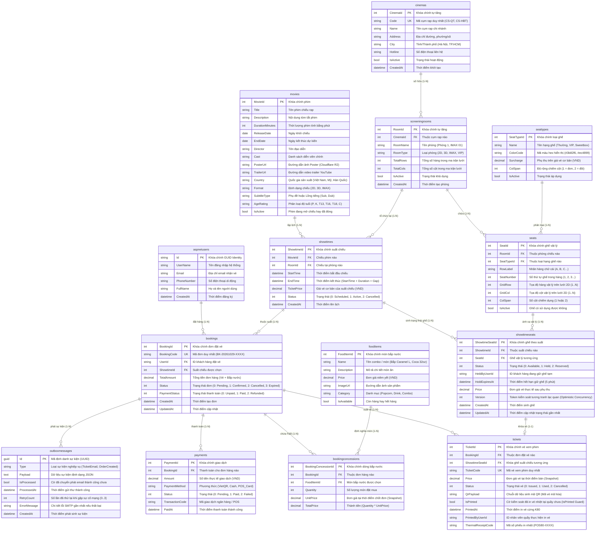

# THIẾT KẾ CƠ SỞ DỮ LIỆU & SƠ ĐỒ THỰC THỂ (3NF ERD)
## HỆ THỐNG QUẢN TRỊ TẬP TRUNG CHUỖI RẠP CHIẾU PHIM (CINEMANAGEMENT)

> **Tài liệu đặc tả**: `02-database-erd.md`  
> **Chuẩn hóa**: Third Normal Form (Dạng chuẩn 3 - 3NF)  
> **Hệ quản trị CSDL**: MariaDB 10.11 / MySQL 8.0 (InnoDB Engine, `utf8mb4_unicode_ci`)  
> **Quy tắc đặc thù**: Sơ đồ ghế 2D đa hành lang & Thuật toán chống tràn ghế đôi Sweetbox (Aisle Guard)

---

## 1. SƠ ĐỒ QUAN HỆ THỰC THỂ MERMAID (ERD ĐẦY ĐỦ CÁC CỘT)

Sơ đồ dưới đây đặc tả đầy đủ 12 thực thể chính của hệ thống với chi tiết toàn bộ các trường, kiểu dữ liệu, khóa chính (PK) và khóa ngoại (FK):



---

## 2. ĐẶC TẢ QUY TẮC SƠ ĐỒ GHẾ 2D ĐA HÀNH LANG (2D MULTI-AISLE MATRIX)

Trong kiến trúc của **CineManagement**, sơ đồ phòng chiếu không phải là danh sách hàng ghế phẳng đơn giản mà là một **Ma trận lưới 2D (`CSS Grid Matrix`)** có kích thước `TotalRows x TotalCols`.

### 2.1. Cấu hình đa hành lang (Multi-Aisle Configuration)
Phòng chiếu hiện đại thường có nhiều lối đi (hành lang giữa, hành lang hai bên, lối thoát hiểm):
* **Hành lang dọc (Vertical Aisles)**: Được xác định bởi danh sách các chỉ số cột trống `AisleCols = [Cột 4, Cột 13]`.
* **Hành lang ngang (Horizontal Aisles)**: Được xác định bởi danh sách các chỉ số hàng trống `AisleRows = [Hàng 6]` (ví dụ phân tách khu vực ghế trước và khu vực VIP phía sau).
* **Quy tắc hiển thị**: Tại các tọa độ `(GridRow, GridCol)` thuộc hành lang, hệ thống không tạo thực thể `Seat`, giao diện HTML/CSS render một khoảng trống trong suốt để người dùng dễ định vị.

### 2.2. Thuật toán đánh nhãn ghế tự động (Auto-Indexing & Labeling)
Hệ thống tự động tính toán tên hàng (`RowLabel`) và số thứ tự ghế (`SeatNumber`) dựa trên tọa độ ma trận:
1. **Nhãn hàng (`RowLabel`)**: Đánh theo thứ tự chữ cái `A, B, C...` từ hàng trên cùng xuống dưới cùng. Nếu một hàng là hành lang ngang (toàn bộ ô đều trống), hàng đó **bị bỏ qua**, hàng ghế kế tiếp mới được tăng chữ cái.
2. **Số thứ tự ghế (`SeatNumber`)**: Đánh số `1, 2, 3...` từ trái qua phải trên từng hàng. Nếu gặp cột hành lang dọc, bộ đếm số ghế **không tăng ở cột hành lang** mà tiếp tục đánh số liên tục cho ghế kế tiếp.
   * *Ví dụ*: Cột 1 là `A1`, Cột 2 là `A2`, Cột 3 là `A3`. Cột 4 là Hành lang lối đi. Cột 5 sẽ là `A4` (không bị nhảy cóc thành A5).

---

## 3. QUY TẮC NGHIÊM NGẶT CHỐNG TRÀN GHẾ ĐÔI SWEETBOX (AISLE GUARD)

Ghế đôi Sweetbox (`SeatType` có `ColSpan = 2`) mang đặc thù chiếm 2 ô cột liên tiếp trên cùng một hàng vật lý: `[GridCol, GridCol + 1]`.

```
Ô Cột 3 [Ghế Đôi Trái]  +  Ô Cột 4 [Ghế Đôi Phải]  ===>  HỢP LỆ (Nếu Cột 4 là ghế bình thường)
Ô Cột 4 [Ghế Đôi Trái]  +  Ô Cột 5 [HÀNH LANG LỐI ĐI]  ===>  VI PHẠM AISLE GUARD (BỊ CHẶN!)
```

### 3.1. Ràng buộc bất biến (Invariants)
1. **Không được lấn sang Cột Hành Lang**: Ô thứ hai của ghế đôi (`GridCol + 1`) tuyệt đối không được trùng với bất kỳ chỉ số cột nào trong danh sách `AisleCols`.
2. **Không được vượt quá Biên Phòng Chiếu**: `GridCol + ColSpan - 1 <= TotalCols`. Ghế đôi đặt ở cột cuối cùng của phòng chiếu là bất hợp lệ.
3. **Tính nguyên tử trong Suất Chiếu**:
   * Khi khách hàng bấm chọn một ghế Sweetbox, hệ thống phải tự động giữ đồng thời cả 2 vị trí cột liên kết và chỉ tính một giá vé trọn gói cho cặp ghế.
   * Khi một nửa của ghế đôi bị giữ, toàn bộ thực thể ghế đôi lập tức chuyển trạng thái sang `Held` trên SignalR Hub.

### 3.2. Thuật toán kiểm tra (Aisle Guard Algorithm)
```csharp
public static bool ValidateSweetboxPlacement(int gridRow, int gridCol, int colSpan, int totalCols, HashSet<int> aisleCols)
{
    // Kiểm tra tràn biên phải của ma trận
    if (gridCol + colSpan - 1 > totalCols)
    {
        return false; // Lỗi: Ghế đôi vượt quá độ rộng phòng chiếu
    }

    // Kiểm tra xem bất kỳ ô nào thuộc độ rộng của ghế có rơi vào hành lang không
    for (int offset = 0; offset < colSpan; offset++)
    {
        int checkCol = gridCol + offset;
        if (aisleCols.Contains(checkCol))
        {
            return false; // Lỗi: Ghế đôi lấn vào cột hành lang lối đi
        }
    }

    return true; // Hợp lệ
}
```
Mọi hành vi vẽ sơ đồ phòng chiếu tại `Visual Seat Layout Builder Studio` vi phạm thuật toán trên đều bị chặn ngay tại Client (JavaScript Validation) và xác thực lại lần 2 tại Backend (`ScreeningRoomController`), bảo đảm tính toàn vẹn 100% của cơ sở dữ liệu.
