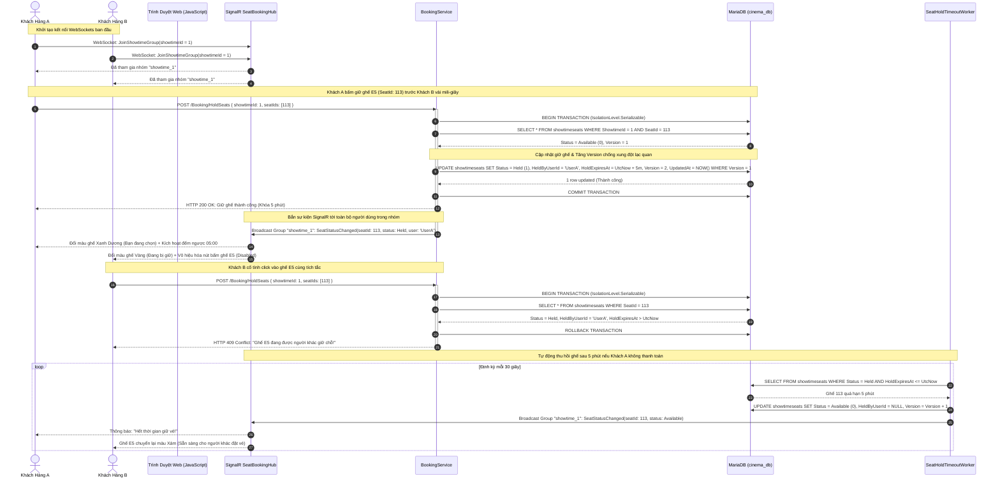
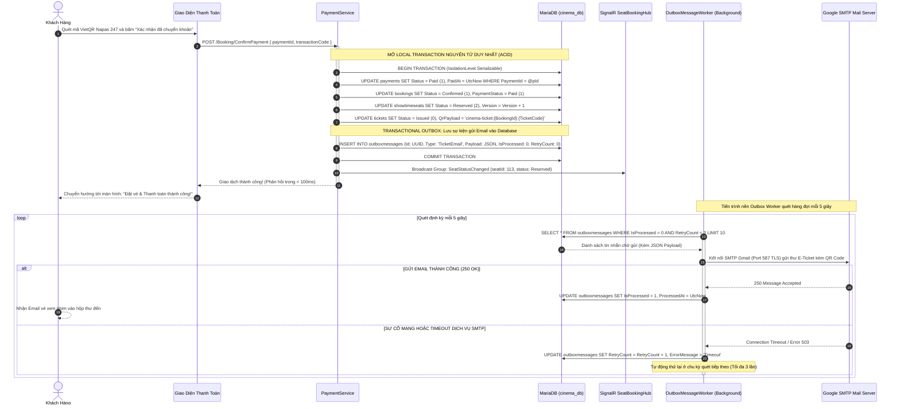
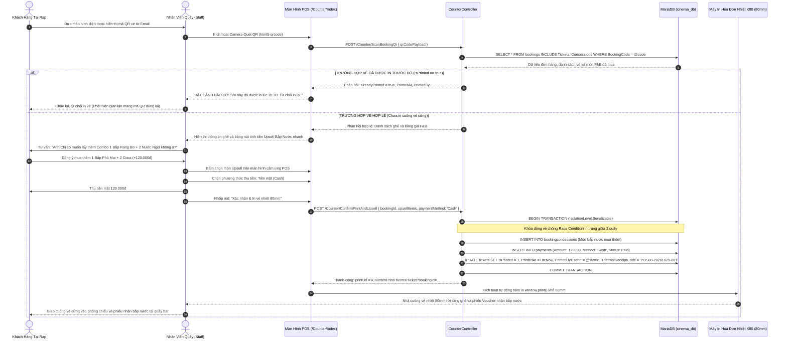

# BIỂU ĐỒ TRÌNH TỰ CÁC LUỒNG NGHIỆP VỤ TRỌNG TÂM (SEQUENCE DIAGRAMS)
## HỆ THỐNG QUẢN TRỊ TẬP TRUNG CHUỖI RẠP CHIẾU PHIM (CINEMANAGEMENT)

> **Tài liệu đặc tả**: `03-workflows-sequences.md`  
> **Mục tiêu**: Chuẩn hóa luồng tương tác thời gian thực, giao dịch tài chính bất biến và quy trình vận hành quầy POS  
> **Công nghệ thực thi**: SignalR WebSockets, EF Core 10 Serializable Isolation, Transactional Outbox Worker, Thermal Print K80

---

## 1. LUỒNG 1: ĐẶT & GIỮ GHẾ REAL-TIME VỚI SIGNALR VÀ DUAL-CONCURRENCY

Biểu đồ mô tả kịch bản hai khách hàng (Khách A và Khách B) cùng truy cập một suất chiếu bom tấn và cùng nhấp chọn ghế `E5`. Cơ chế kết hợp giữa **SignalR Hub** và **Dual-Concurrency Engine** giải quyết triệt để tranh chấp:

---

## 2. LUỒNG 2: THANH TOÁN VIETQR & TRANSACTIONAL OUTBOX PATTERN

Biểu đồ mô tả tiến trình thanh toán trực tuyến qua mã VietQR, cam kết tính toàn vẹn giao dịch $ACID$ và bảo đảm 100% email vé điện tử kèm mã QR được gửi thành công mà không làm nghẽn luồng người dùng:

---

## 3. LUỒNG 3: QUẦY VÉ BOX OFFICE POS (QUÉT QR + KIỂM TRA ISPRINTED + UPSELL F&B + IN NHIỆT K80)

Biểu đồ mô tả quy trình phục vụ "Một Cửa" của Nhân viên quầy (`Staff`) tại cổng `/Counter`:

