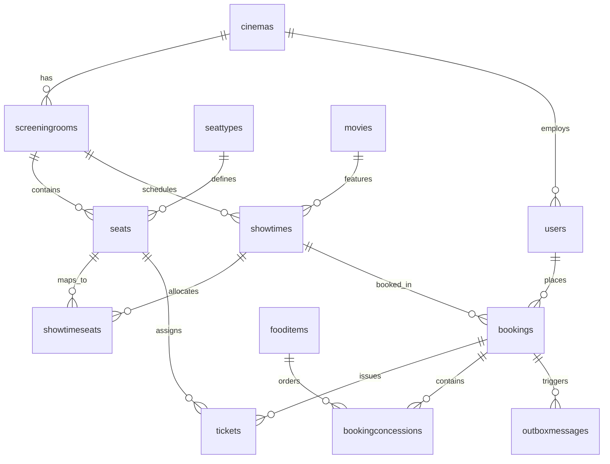
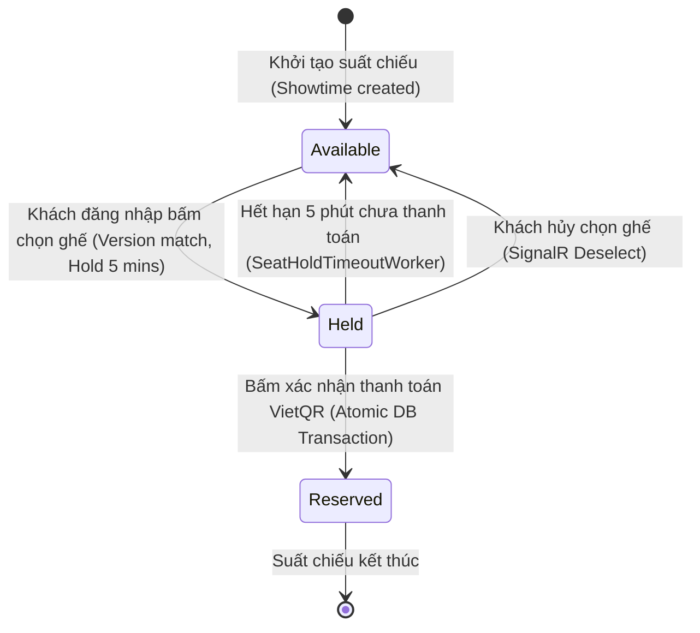

# Data Model & Schema Specification: CineManagement (CLO1 Edition)

**Feature**: `001-cinema-chain-booking` | **Date**: 2026-11-04  
**Architecture Standard**: Modular Monolith & Relational 3NF Schema (MariaDB 10.11 / MySQL 8.0 InnoDB)

---

## 1. Danh sách thực thể & Phân rã theo Bounded Context

Mô hình dữ liệu tuân thủ nghiêm ngặt nguyên tắc **Modular Monolith**, được chia thành các phân hệ logic (Bounded Contexts):

```text
┌───────────────────────┐   ┌───────────────────────┐   ┌───────────────────────┐
│    MODULE: CINEMAS    │   │    MODULE: CATALOG    │   │   MODULE: TICKETING   │
│ ───────────────────── │   │ ───────────────────── │   │ ───────────────────── │
│ - Cinema              │   │ - Movie               │   │ - Showtime            │
│ - ScreeningRoom       │   │ - FoodItem            │   │ - ShowtimeSeat        │
│ - Seat                │   └───────────────────────┘   │ - Ticket              │
│ - SeatType            │                               └───────────────────────┘
└───────────────────────┘
           │                                                        │
           ▼                                                        ▼
┌───────────────────────┐                               ┌───────────────────────┐
│   MODULE: ORDERING    │<──────────────────────────────┤    MODULE: SHARED     │
│ ───────────────────── │                               │ ───────────────────── │
│ - Booking             │                               │ - OutboxMessage       │
│ - BookingConcession   │                               │ - StorageSettings     │
└───────────────────────┘                               └───────────────────────┘
           │
           ▼
┌───────────────────────┐
│     MODULE: USERS     │
│ ───────────────────── │
│ - ApplicationUser     │
└───────────────────────┘
```

---

## 2. Chi tiết các bảng thực thể (Entities Definition)

### A. Bounded Context: Cinemas

#### 1. `cinemas` (Cụm rạp chi nhánh)
| Cột | Kiểu dữ liệu | Ràng buộc | Mô tả |
| :--- | :--- | :--- | :--- |
| `CinemaId` | `INT` | `PK, AUTO_INCREMENT` | Khóa chính cụm rạp |
| `CinemaCode` | `VARCHAR(20)` | `NOT NULL, UNIQUE` | Mã định danh chi nhánh (ví dụ: `CINE-Q1`) |
| `Name` | `VARCHAR(150)` | `NOT NULL` | Tên cụm rạp |
| `Address` | `VARCHAR(255)` | `NOT NULL` | Địa chỉ cụ thể |
| `City` | `VARCHAR(100)` | `NOT NULL` | Tỉnh / Thành phố |
| `Hotline` | `VARCHAR(20)` | `NOT NULL` | Số điện thoại đường dây nóng |
| `Email` | `VARCHAR(100)` | `NOT NULL` | Email liên hệ chi nhánh |
| `IsActive` | `BOOLEAN` | `NOT NULL, DEFAULT TRUE` | Trạng thái hoạt động |
| `CreatedAt` | `DATETIME` | `NOT NULL` | Thời điểm tạo |

#### 2. `screeningrooms` (Phòng chiếu 2D)
| Cột | Kiểu dữ liệu | Ràng buộc | Mô tả |
| :--- | :--- | :--- | :--- |
| `RoomId` | `INT` | `PK, AUTO_INCREMENT` | Khóa chính phòng chiếu |
| `CinemaId` | `INT` | `FK -> cinemas.CinemaId` | Cụm rạp sở hữu phòng chiếu |
| `RoomName` | `VARCHAR(100)` | `NOT NULL` | Tên phòng (ví dụ: `Cinema 01 - IMAX`) |
| `RoomType` | `INT` | `NOT NULL` | Loại phòng (0: Standard, 1: VIP, 2: IMAX) |
| `TotalRows` | `INT` | `NOT NULL, Range(3..30)` | Tổng số hàng trong ma trận lưới 2D |
| `TotalCols` | `INT` | `NOT NULL, Range(4..40)` | Tổng số cột trong ma trận lưới 2D |
| `AisleRows` | `VARCHAR(255)` | `NULLABLE` | Danh sách hàng hành lang ngang (ví dụ: `"4,9"`) |
| `AisleCols` | `VARCHAR(255)` | `NULLABLE` | Danh sách cột hành lang dọc (ví dụ: `"5,12"`) |
| `Description`| `VARCHAR(500)` | `NULLABLE` | Mô tả phòng chiếu |
| `IsActive` | `BOOLEAN` | `NOT NULL, DEFAULT TRUE` | Trạng thái phòng chiếu |

#### 3. `seattypes` (Phân loại ghế & Quy cách ColSpan)
| Cột | Kiểu dữ liệu | Ràng buộc | Mô tả |
| :--- | :--- | :--- | :--- |
| `SeatTypeId` | `INT` | `PK, AUTO_INCREMENT` | Khóa chính loại ghế |
| `Code` | `VARCHAR(50)` | `NOT NULL, UNIQUE` | Mã loại: `STANDARD`, `VIP`, `COUPLE` |
| `Name` | `VARCHAR(100)` | `NOT NULL` | Tên hiển thị (Ghế Thường, VIP, Đôi) |
| `Surcharge` | `DECIMAL(15,0)`| `NOT NULL, DEFAULT 0` | Mức phụ thu (VNĐ) |
| `ColSpan` | `INT` | `NOT NULL, Range(1..2)` | Số ô lưới chiếm dụng (1: Đơn, 2: Đôi) |
| `ColorCode` | `VARCHAR(20)` | `NOT NULL` | Mã màu Hex hiển thị sơ đồ (ví dụ: `#9333ea`) |
| `IsActive` | `BOOLEAN` | `NOT NULL, DEFAULT TRUE` | Trạng thái sử dụng |

#### 4. `seats` (Ghế vật lý trong phòng)
| Cột | Kiểu dữ liệu | Ràng buộc | Mô tả |
| :--- | :--- | :--- | :--- |
| `SeatId` | `INT` | `PK, AUTO_INCREMENT` | Khóa chính ghế |
| `RoomId` | `INT` | `FK -> screeningrooms.RoomId`| Phòng chiếu sở hữu ghế |
| `RowLabel` | `VARCHAR(5)` | `NOT NULL` | Nhãn hàng chữ (A, B, C... bỏ qua lối đi ngang) |
| `SeatNumber` | `INT` | `NOT NULL` | Số thứ tự ghế (1, 2, 3... bỏ qua lối đi dọc) |
| `GridRow` | `INT` | `NOT NULL` | Tọa độ hàng trên lưới 2D (1..TotalRows) |
| `GridCol` | `INT` | `NOT NULL` | Tọa độ cột trên lưới 2D (1..TotalCols) |
| `SeatTypeId` | `INT` | `FK -> seattypes.SeatTypeId` | Loại ghế và mức phụ thu tương ứng |
| `IsActive` | `BOOLEAN` | `NOT NULL, DEFAULT TRUE` | Ghế hoạt động hay đang hỏng/khóa bảo trì |

---

### B. Bounded Context: Catalog

#### 5. `movies` (Kho phim dùng chung toàn chuỗi)
| Cột | Kiểu dữ liệu | Ràng buộc | Mô tả |
| :--- | :--- | :--- | :--- |
| `MovieId` | `INT` | `PK, AUTO_INCREMENT` | Khóa chính phim |
| `Title` | `VARCHAR(250)` | `NOT NULL` | Tên phim |
| `Description`| `TEXT` | `NOT NULL` | Tóm tắt nội dung phim |
| `Director` | `VARCHAR(150)` | `NOT NULL` | Đạo diễn |
| `Cast` | `VARCHAR(500)` | `NOT NULL` | Diễn viên chính |
| `DurationMinutes`| `INT` | `NOT NULL` | Thời lượng phim (phút) |
| `AgeRating` | `VARCHAR(10)` | `NOT NULL` | Giới hạn độ tuổi (P, K, T13, T16, T18, C) |
| `PosterUrl` | `VARCHAR(500)` | `NOT NULL` | Đường dẫn ảnh áp phích trên Cloudflare R2 / MinIO |
| `TrailerUrl` | `VARCHAR(500)` | `NULLABLE` | Đường dẫn video trailer |
| `ReleaseDate`| `DATE` | `NOT NULL` | Ngày khởi chiếu |
| `EndDate` | `DATE` | `NOT NULL` | Ngày kết thúc dự kiến |
| `IsActive` | `BOOLEAN` | `NOT NULL, DEFAULT TRUE` | Trạng thái phát hành |

#### 6. `fooditems` (Danh mục bắp nước & Combo F&B)
| Cột | Kiểu dữ liệu | Ràng buộc | Mô tả |
| :--- | :--- | :--- | :--- |
| `FoodItemId` | `INT` | `PK, AUTO_INCREMENT` | Khóa chính sản phẩm F&B |
| `Name` | `VARCHAR(150)` | `NOT NULL` | Tên Combo / Món (ví dụ: `Combo Bắp Nước Sweet`) |
| `Description`| `VARCHAR(500)` | `NULLABLE` | Mô tả chi tiết món ăn / thức uống |
| `Price` | `DECIMAL(15,0)`| `NOT NULL` | Giá bán lẻ (VNĐ) |
| `ImageUrl` | `VARCHAR(500)` | `NULLABLE` | Đường dẫn ảnh món trên S3 Storage |
| `IsActive` | `BOOLEAN` | `NOT NULL, DEFAULT TRUE` | Trạng thái mở bán (Menu Toggle) |

---

### C. Bounded Context: Ticketing

#### 7. `showtimes` (Lịch chiếu phim)
| Cột | Kiểu dữ liệu | Ràng buộc | Mô tả |
| :--- | :--- | :--- | :--- |
| `ShowtimeId` | `INT` | `PK, AUTO_INCREMENT` | Khóa chính suất chiếu |
| `MovieId` | `INT` | `FK -> movies.MovieId` | Bộ phim được chiếu |
| `RoomId` | `INT` | `FK -> screeningrooms.RoomId`| Phòng chiếu diễn ra suất chiếu |
| `StartTime` | `DATETIME` | `NOT NULL` | Giờ bắt đầu suất chiếu |
| `EndTime` | `DATETIME` | `NOT NULL` | Giờ kết thúc (StartTime + Duration + Cleaning) |
| `BasePrice` | `DECIMAL(15,0)`| `NOT NULL` | Giá vé tiêu chuẩn cơ bản của suất chiếu |
| `Status` | `INT` | `NOT NULL, DEFAULT 0` | 0: Sắp chiếu, 1: Đang chiếu, 2: Đã xong, 3: Đã hủy |

#### 8. `showtimeseats` (Trạng thái ghế theo suất chiếu & Token chống tranh chấp)
| Cột | Kiểu dữ liệu | Ràng buộc | Mô tả |
| :--- | :--- | :--- | :--- |
| `ShowtimeSeatId`| `INT` | `PK, AUTO_INCREMENT` | Khóa chính trạng thái ghế |
| `ShowtimeId` | `INT` | `FK -> showtimes.ShowtimeId`| Suất chiếu |
| `SeatId` | `INT` | `FK -> seats.SeatId` | Ghế vật lý tương ứng |
| `Status` | `INT` | `NOT NULL, DEFAULT 0` | **0: Available, 1: Held, 2: Reserved** |
| `HeldByUserId` | `VARCHAR(450)`| `NULLABLE` | Khóa ngoại người đang giữ ghế tạm thời |
| `HoldExpiresAt`| `DATETIME` | `NULLABLE` | Thời điểm hết hạn giữ ghế (tối đa 5 phút) |
| `Version` | `INT` | `NOT NULL, DEFAULT 1` | **Optimistic Concurrency Check Token** |

#### 9. `tickets` (Vé điện tử & Vé in nhiệt)
| Cột | Kiểu dữ liệu | Ràng buộc | Mô tả |
| :--- | :--- | :--- | :--- |
| `TicketId` | `INT` | `PK, AUTO_INCREMENT` | Khóa chính vé |
| `BookingId` | `INT` | `FK -> bookings.BookingId` | Đơn hàng sở hữu vé |
| `SeatId` | `INT` | `FK -> seats.SeatId` | Ghế của vé |
| `TicketCode` | `VARCHAR(32)` | `NOT NULL, UNIQUE` | Mã vé duy nhất |
| `QrCodeData` | `VARCHAR(255)` | `NOT NULL` | Nội dung chuỗi mã QR quét vé |
| `Price` | `DECIMAL(15,0)`| `NOT NULL` | Giá vé (BasePrice + Seat Surcharge) |
| `IsPrinted` | `BOOLEAN` | `NOT NULL, DEFAULT FALSE`| Đã in nhiệt K80 tại quầy chưa |
| `PrintedAt` | `DATETIME` | `NULLABLE` | Thời điểm in vé nhiệt |
| `PrintedByStaffId`| `VARCHAR(450)`| `NULLABLE` | Nhân viên quầy thực hiện in vé |

---

### D. Bounded Context: Ordering & Payments

#### 10. `bookings` (Đơn đặt vé & Thông tin thanh toán)
| Cột | Kiểu dữ liệu | Ràng buộc | Mô tả |
| :--- | :--- | :--- | :--- |
| `BookingId` | `INT` | `PK, AUTO_INCREMENT` | Khóa chính đơn hàng |
| `BookingCode`| `VARCHAR(20)` | `NOT NULL, UNIQUE` | Mã đơn hàng (ví dụ: `BK-20261104-X7A9`) |
| `UserId` | `VARCHAR(450)`| `NULLABLE` | Khách hàng đặt (NOT NULL nếu Online, NULL nếu Walk-in) |
| `SoldByStaffId`| `VARCHAR(450)`| `NULLABLE` | Nhân viên bán vé (nếu là giao dịch Walk-in tại quầy) |
| `ShowtimeId` | `INT` | `FK -> showtimes.ShowtimeId`| Suất chiếu của đơn |
| `Channel` | `INT` | `NOT NULL` | Kênh bán (0: Online Web, 1: Counter Walk-in) |
| `TicketAmount`| `DECIMAL(15,0)`| `NOT NULL` | Tổng tiền vé |
| `FnBAmount` | `DECIMAL(15,0)`| `NOT NULL, DEFAULT 0` | Tổng tiền F&B bắp nước |
| `DiscountAmount`| `DECIMAL(15,0)`| `NOT NULL, DEFAULT 0` | Số tiền giảm trừ khuyến mãi |
| `FinalAmount`| `DECIMAL(15,0)`| `NOT NULL` | Tổng tiền thanh toán cuối cùng |
| `PaymentMethod`| `INT` | `NOT NULL` | Phương thức (0: VietQR Napas247, 1: Tiền mặt) |
| `PaymentReference`| `VARCHAR(100)`| `NULLABLE` | Mã giao dịch tham chiếu VietQR |
| `Status` | `INT` | `NOT NULL, DEFAULT 0` | 0: Pending, 1: Paid, 2: Cancelled, 3: Refunded |
| `ContactEmail`| `VARCHAR(100)`| `NOT NULL` | Email nhận vé điện tử |
| `ContactPhone`| `VARCHAR(20)` | `NOT NULL` | Số điện thoại liên hệ |
| `PaidAt` | `DATETIME` | `NULLABLE` | Thời điểm thanh toán thành công |
| `CreatedAt` | `DATETIME` | `NOT NULL` | Thời điểm tạo đơn |

#### 11. `bookingconcessions` (Chi tiết bắp nước trong đơn)
| Cột | Kiểu dữ liệu | Ràng buộc | Mô tả |
| :--- | :--- | :--- | :--- |
| `BookingConcessionId`| `INT` | `PK, AUTO_INCREMENT` | Khóa chính dòng sản phẩm F&B |
| `BookingId` | `INT` | `FK -> bookings.BookingId`| Đơn hàng |
| `FoodItemId` | `INT` | `FK -> fooditems.FoodItemId`| Món ăn / Thức uống |
| `Quantity` | `INT` | `NOT NULL, Range(1..20)` | Số lượng mua |
| `UnitPrice` | `DECIMAL(15,0)`| `NOT NULL` | Đơn giá tại thời điểm mua |
| `IsUpsell` | `BOOLEAN` | `NOT NULL, DEFAULT FALSE`| Mua thêm trực tiếp tại quầy vé (Upsell) |

---

### E. Bounded Context: Shared Infrastructure & Users

#### 12. `outboxmessages` (Hàng đợi gửi vé Transactional Outbox)
| Cột | Kiểu dữ liệu | Ràng buộc | Mô tả |
| :--- | :--- | :--- | :--- |
| `Id` | `BIGINT` | `PK, AUTO_INCREMENT` | Khóa chính tin nhắn outbox |
| `EventType` | `VARCHAR(100)`| `NOT NULL` | Tên sự kiện: `TicketIssuedEvent`, `BookingConfirmedEvent` |
| `PayloadJson`| `LONGTEXT` | `NOT NULL` | Nội dung JSON đơn hàng & thông tin vé kèm QR |
| `Status` | `INT` | `NOT NULL, DEFAULT 0` | 0: Pending, 1: Processed, 2: Failed |
| `RetryCount` | `INT` | `NOT NULL, DEFAULT 0` | Số lần thử lại (tối đa 3 lần) |
| `ErrorMessage`| `TEXT` | `NULLABLE` | Chi tiết lỗi mạng hoặc SMTP gần nhất |
| `CreatedAt` | `DATETIME` | `NOT NULL` | Thời điểm sinh tin nhắn trong cùng DB Transaction |
| `ProcessedAt`| `DATETIME` | `NULLABLE` | Thời điểm chuyển phát email thành công |

#### 13. `users` (Identity ApplicationUser)
| Cột | Kiểu dữ liệu | Ràng buộc | Mô tả |
| :--- | :--- | :--- | :--- |
| `Id` | `VARCHAR(450)`| `PK` | Khóa chính Identity User |
| `UserName` | `VARCHAR(256)` | `NOT NULL, UNIQUE` | Tên đăng nhập |
| `Email` | `VARCHAR(256)` | `NOT NULL, UNIQUE` | Email người dùng |
| `FullName` | `VARCHAR(150)` | `NOT NULL` | Họ và tên |
| `PhoneNumber`| `VARCHAR(20)` | `NULLABLE` | Số điện thoại |
| `RoleName` | `VARCHAR(50)` | `NOT NULL` | Vai trò: `Customer`, `Staff`, `Admin` |
| `CinemaId` | `INT` | `NULLABLE, FK -> cinemas`| Cụm rạp phân công làm việc (nếu là `Staff`) |
| `IsActive` | `BOOLEAN` | `NOT NULL, DEFAULT TRUE` | Trạng thái tài khoản |

---

## 3. Biểu đồ quan hệ thực thể (ERD - Modular Monolith)



---

## 4. Bảng chuyển trạng thái ghế (ShowtimeSeat State Machine)


