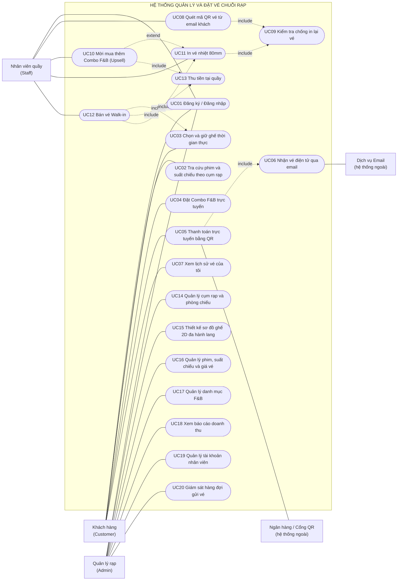
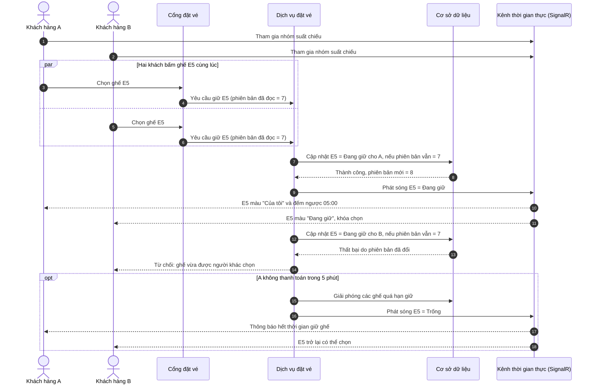
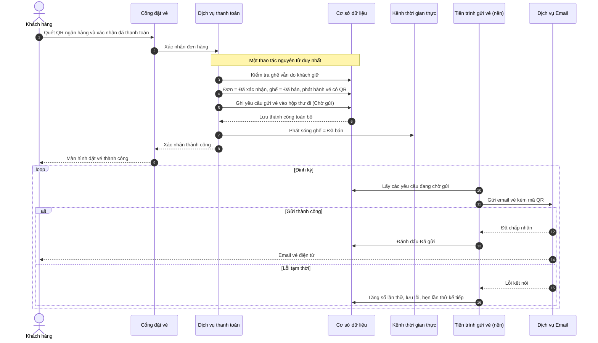
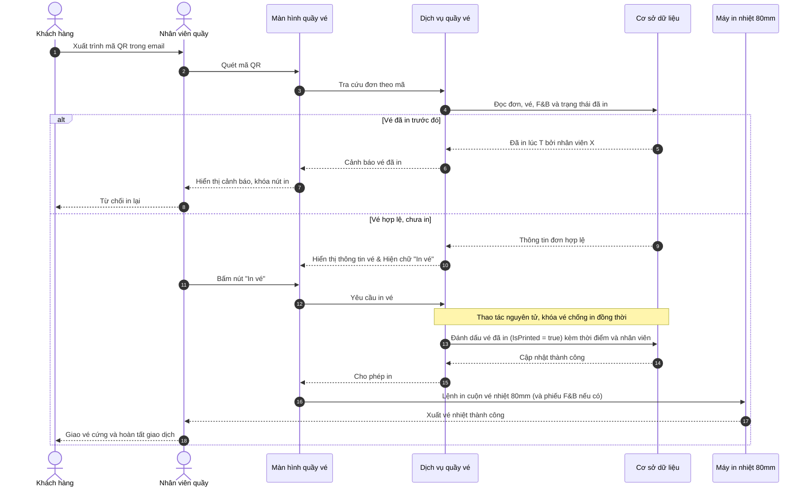

# Feature Specification: Hệ thống Quản lý và Đặt vé cho Hãng rạp chiếu phim đa chi nhánh

**Feature Branch**: `001-cinema-chain-booking`

**Created**: 2026-11-03

**Status**: Draft

**Input**: User description: "Đặc tả toàn diện hệ thống Quản lý và Đặt vé cho một Hãng rạp chiếu phim đa chi nhánh (Cinemas): Viết lại Lý do chọn đề tài giải quyết 3 bài toán: Quản trị chuỗi cụm rạp tập trung, Chống tranh chấp ghế thời gian thực (SignalR + Optimistic Concurrency), và Chống mất vé điện tử (Transactional Outbox Pattern). Phân quyền RBAC cho 3 Actor: Khách hàng (Customer), Nhân viên quầy (Staff - Quét QR từ email khách, mời mua thêm Combo F&B Upsell và in vé nhiệt 80mm, bán vé Walk-in), Quản lý rạp (Admin - Quản lý cụm rạp, thiết kế sơ đồ ghế 2D đa hành lang, xem báo cáo). Vẽ đầy đủ sơ đồ Use Case, ERD 12 bảng (khai báo đủ thuộc tính cho cả bảng users và movies) và 3 Sequence Diagrams bằng Mermaid."

## Bối cảnh & Lý do chọn đề tài

Một hãng rạp chiếu phim đa chi nhánh phục vụ hàng nghìn khán giả mỗi ngày qua hai kênh song song: đặt vé trực tuyến và mua vé trực tiếp tại quầy. Vào giờ cao điểm hoặc khi phim "bom tấn" ra rạp, lượng truy cập tăng đột biến và bộc lộ ba bài toán cốt lõi mà đề tài này giải quyết:

### Bài toán 1 — Quản trị chuỗi cụm rạp tập trung

- **Thực trạng**: Mỗi chi nhánh thường tự quản lý phim, lịch chiếu, giá vé và sơ đồ phòng chiếu riêng lẻ. Dữ liệu phân mảnh khiến ban điều hành không có cái nhìn tổng thể về doanh thu và công suất; mở thêm chi nhánh mới phải cấu hình thủ công từng ghế, tốn nhiều ngày và dễ sai sót.
- **Hướng giải quyết**: Một nền tảng duy nhất quản lý toàn bộ chuỗi: danh mục cụm rạp, phòng chiếu, kho phim dùng chung, lịch chiếu theo từng chi nhánh, cùng công cụ thiết kế sơ đồ ghế 2D trực quan hỗ trợ nhiều hành lang và ghế đôi. Báo cáo doanh thu được hợp nhất theo chi nhánh, theo phim và theo thời gian.

### Bài toán 2 — Chống tranh chấp ghế thời gian thực (SignalR + Optimistic Concurrency)

- **Thực trạng**: Nhiều khách hàng (trực tuyến và tại quầy) cùng nhắm vào một ghế đẹp trong cùng một khoảnh khắc. Hệ thống truyền thống chỉ phát hiện xung đột ở bước thanh toán, gây ra bán trùng ghế (double booking) hoặc buộc khách làm lại từ đầu, gây ức chế và tranh cãi tại cửa phòng chiếu.
- **Hướng giải quyết**:
  - **Đồng bộ thời gian thực (SignalR)**: Mọi thay đổi trạng thái ghế (Trống → Đang giữ → Đã bán) được đẩy tức thì đến tất cả người đang xem cùng suất chiếu mà không cần tải lại trang.
  - **Kiểm soát tương tranh lạc quan (Optimistic Concurrency)**: Mỗi ghế của suất chiếu mang một số phiên bản. Khi hai yêu cầu giữ cùng một ghế đến đồng thời, chỉ yêu cầu khớp phiên bản đầu tiên được chấp nhận; yêu cầu còn lại bị từ chối ngay lập tức với thông báo rõ ràng.
  - **Giữ chỗ có thời hạn**: Ghế được giữ tối đa 5 phút; quá hạn chưa thanh toán sẽ tự động được giải phóng cho người khác.

### Bài toán 3 — Chống mất vé điện tử (Transactional Outbox Pattern)

- **Thực trạng**: Sau khi khách thanh toán, hệ thống phải vừa ghi nhận đơn hàng vừa gửi email vé. Nếu dịch vụ email gặp sự cố mạng đúng lúc đó, khách bị trừ tiền nhưng không nhận được vé — dẫn tới khiếu nại và mất uy tín.
- **Hướng giải quyết**: Việc xác nhận đơn hàng và việc "ghi lại yêu cầu gửi vé" được lưu cùng nhau như một thao tác nguyên tử duy nhất (cùng thành công hoặc cùng thất bại). Một tiến trình nền độc lập đọc các yêu cầu gửi vé đang chờ và chuyển phát email, tự động thử lại khi gặp lỗi. Nhờ đó không một vé đã thanh toán nào bị thất lạc, và khách nhận được xác nhận thành công ngay mà không phải chờ quá trình gửi email.

### So sánh với các hệ thống hiện có trên thị trường & Đồ án học thuật

Điểm khác biệt cốt lõi của đề tài không nằm ở việc phát minh ra một mô hình kinh doanh mới chưa từng tồn tại, mà nằm ở **phân khúc mục tiêu, mức độ tùy biến vận hành, và việc giải quyết triệt để khoảng trống giữa "hệ thống Enterprise đắt đỏ" với "các đồ án sinh viên sơ sài"**.

#### 1. So với hệ thống Enterprise của các "ông lớn" (CGV, Lotte Cinema — dùng phần mềm Vista Cinema của New Zealand)
- **Thực trạng trên thị trường**: Các chuỗi lớn dùng hệ thống ERP ngoại nhập (như Vista) với chi phí bản quyền và hạ tầng Microservices lên tới hàng trăm nghìn USD/năm, đòi hỏi đội ngũ IT riêng biệt và hệ thống máy Kiosk tự phục vụ đắt tiền. Các hãng rạp nội địa quy mô vừa và nhỏ (từ 2–5 cụm rạp địa phương hoặc rạp tư nhân) hoàn toàn không đủ ngân sách tiếp cận.
- **Sự khác biệt của đề tài**: Hệ thống được thiết kế theo kiến trúc **Modular Monolith** đóng gói gọn trong Docker Compose và chạy trên 1 VPS chi phí thấp kết hợp lưu trữ Cloudflare R2 miễn phí/giá rẻ. Nó mang lại sức mạnh quản lý chuỗi đa chi nhánh (realtime, chống trùng vé, báo cáo tập trung) nhưng với **chi phí hạ tầng tiệm cận 0 đồng**, vừa vặn cho các hãng rạp vừa và nhỏ tại Việt Nam.

#### 2. So với các phần mềm bán vé POS đóng gói sẵn (SaaS giá rẻ trên thị trường)
- **Thực trạng trên thị trường**: Các phần mềm bán vé giá rẻ thường đóng cứng sơ đồ ghế dạng lưới chữ nhật cố định, hoặc tách rời phần mềm bán tại quầy (POS) với website đặt vé online khiến dữ liệu đồng bộ chậm, dễ xảy ra tình trạng khách online và nhân viên quầy bán trùng 1 ghế.
- **Sự khác biệt của đề tài**:
  - **Trình thiết kế sơ đồ ghế 2D linh hoạt (Visual Seat Layout Builder)**: Cho phép Quản lý rạp tự cấu hình nhiều hành lang dọc/ngang, gán hạng ghế đơn/đôi (`ColSpan = 2`) theo thực tế mặt bằng kiến trúc của từng phòng chiếu mà không cần lập trình viên can thiệp sửa code.
  - **Đồng bộ tức thời Web Online & Quầy POS trên cùng một lõi SignalR**: Nhân viên quầy thao tác chọn ghế Walk-in và khách hàng đặt trên Web cùng nhìn thấy một nguồn trạng thái duy nhất (`showtime_seats`) theo thời gian thực.

#### 3. Tối ưu hóa quy trình "Một cửa" (Single-Counter Redemption & Upsell) thay vì tách rời
- **Thực trạng trên thị trường**: Ở nhiều rạp hiện nay, khách mua vé online xong khi đến rạp nếu muốn mua thêm bắp nước lại phải xếp hàng chờ bấm bill mới từ đầu rất mất thời gian; hoặc rạp phải bố trí 1 nhân viên đứng quầy vé và 1 nhân viên đứng soát vé ở cửa phòng chiếu.
- **Sự khác biệt của đề tài**: Gộp luồng **Quét QR đổi vé online + Bán chéo thêm Combo F&B (Upsell) + In vé nhiệt 80mm** vào chung một màn hình thao tác 10 giây của Nhân viên quầy. Ngay khi quét mã QR từ email khách, hệ thống tự động nạp thông tin đơn cũ và mở sẵn menu chọn thêm bắp nước, vừa giúp rạp cắt giảm nhân sự đứng cửa phòng chiếu, vừa tăng doanh thu F&B tại điểm chạm cuối cùng.

#### 4. So với mặt bằng chung các đồ án sinh viên cùng đề tài
- **Thực trạng đồ án thông thường**: 90% đồ án đặt vé rạp phim chỉ dừng ở mức CRUD cơ bản: lưu trạng thái ghế vào thẳng bảng `Seats`, gọi hàm gửi mail đồng bộ làm treo giao diện, hoặc dùng `Task.Run` dễ làm mất vé khi lỗi mạng.
- **Sự khác biệt của đề tài**: Đề tài áp dụng đúng các **Design Patterns chuẩn công nghiệp (Production-grade)** vào một codebase thực tế: **Optimistic Concurrency Control (`Version`)** chống Race Condition, **Transactional Outbox Pattern** đảm bảo gửi vé QR 100%, và tích hợp **Cloudflare R2 + NGINX SSL** chạy thật trên môi trường mạng.

> *"Dù trên thị trường đã có các hệ thống quản lý rạp quy mô lớn (như Vista của CGV/Lotte), các giải pháp này có chi phí bản quyền và hạ tầng quá cao đối với các hãng rạp nội địa quy mô vừa và nhỏ. Ngược lại, các phần mềm nhỏ lẻ lại thiếu khả năng tùy biến mặt bằng phòng chiếu đa hành lang và dễ gặp lỗi tranh chấp dữ liệu giữa kênh Online và tại Quầy. Do đó, đề tài tập trung xây dựng một giải pháp **tinh gọn về hạ tầng (Modular Monolith trên Docker & Cloudflare R2)** nhưng **mạnh mẽ về nghiệp vụ lõi (SignalR Realtime, Transactional Outbox và Quầy POS Một Cửa tích hợp Upsell F&B)**, đáp ứng đúng bài toán chuyển đổi số thực tế với chi phí tối ưu nhất."*

## Clarifications

### Session 2026-11-03
- Q: Khi vé in nhiệt tại quầy gặp sự cố (kẹt giấy, hết giấy, mờ mực), quy trình phê duyệt in lại vé sẽ được thực hiện như thế nào để vừa chống gian lận vừa không làm nghẽn hàng đợi tại quầy? (FR-040) → A: Giả định thiết bị in nhiệt vận hành ổn định không kẹt giấy; quy trình nhân viên quầy tối giản một chạm: quét mã QR của khách → hệ thống hiển thị thông tin vé cùng nút "In vé" → nhân viên bấm "In vé" → máy in vé nhiệt và hoàn tất giao dịch. Vé sau khi in chuyển IsPrinted = true vĩnh viễn và không hỗ trợ in lại dưới mọi hình thức nhằm loại bỏ hoàn toàn nguy cơ gian lận vé.
- Q: Trong trường hợp khách hàng chuyển khoản VietQR thành công nhưng tiền về hệ thống sau khi đã quá hạn giữ chỗ 5 phút và ghế đó đã bị người khác mua mất, hệ thống sẽ xử lý giao dịch này như thế nào? (FR-025) → A: Đối với phạm vi dự án, không tích hợp cổng thanh toán ngân hàng thực tế mà chỉ sinh mã VietQR động; thao tác bấm xác nhận thanh toán được xử lý tức thì và thành công 100%, không phát sinh độ trễ hay trường hợp hoàn tiền do thanh toán trễ quá hạn.
- Q: Khi khách hàng chọn vị trí ghế trên sơ đồ 2D trực tuyến, hệ thống có áp dụng quy tắc chặn ghế trống đơn lẻ (Orphan Seat Policy) không? → A: Tự do hoàn toàn (Phương án C): Hệ thống không áp dụng quy tắc kiểm tra ghế trống đơn lẻ và không hiển thị cảnh báo; khách hàng được tự do chọn bất kỳ vị trí ghế nào còn trống trên sơ đồ 2D.
- Q: Khi khách hàng đặt vé trực tuyến trên website, hệ thống có bắt buộc người dùng phải đăng nhập tài khoản trước khi giữ ghế và thanh toán không, hay cho phép đặt vé nhanh dưới dạng khách vãng lai (Guest Checkout)? (FR-001) → A: Bắt buộc đăng nhập trước khi giữ ghế (Phương án A): Khách hàng phải đăng nhập tài khoản trước khi truy cập vào sơ đồ ghế để chọn và giữ ghế; toàn bộ đơn đặt trực tuyến đều bắt buộc liên kết với UserId tài khoản người dùng (UserId NOT NULL) nhằm triệt tiêu nguy cơ bot ẩn danh spam giữ ghế ảo và đảm bảo 100% đơn đặt trực tuyến được lưu vết trong "Vé của tôi". Đơn hàng tại quầy (Walk-in) do nhân viên quầy thực hiện thì UserId có thể để trống (NULL) nhưng bắt buộc phải có SoldByStaffId.
- Q: Khách hàng có được phép tự hủy vé đã thanh toán thành công trên website để hoàn tiền/đổi vé không, hay hệ thống áp dụng quy tắc vé đã mua không thể hoàn/hủy trực tuyến? (FR-031) → A: Không hỗ trợ hoàn/hủy trực tuyến (Phương án A): Vé và đơn hàng đã thanh toán thành công được coi là giao dịch dứt điểm, hệ thống không cung cấp chức năng tự hủy vé, đổi suất chiếu hay hoàn tiền trực tuyến cho khách hàng. Trạng thái hủy vé chỉ phát sinh khi Quản lý rạp chủ động hủy suất chiếu do sự cố kỹ thuật hoặc trường hợp bất khả kháng, lúc này các vé liên quan được chuyển sang trạng thái "Đã hủy" và được lưu vết để xử lý bồi hoàn thủ công tại rạp.

## Phân quyền theo vai trò (RBAC)

| Vai trò | Phạm vi truy cập | Chức năng được phép | Bị cấm |
| :--- | :--- | :--- | :--- |
| **Khách hàng (Customer)** | Cổng đặt vé trực tuyến | Đăng ký/đăng nhập; tra cứu phim & suất chiếu theo cụm rạp; chọn và giữ ghế; đặt Combo F&B; thanh toán trực tuyến; nhận vé điện tử qua email; xem lịch sử vé của chính mình | Mọi chức năng quầy vé và quản trị; xem dữ liệu của khách khác; tự hủy vé, đổi suất chiếu hoặc yêu cầu hoàn tiền trực tuyến |
| **Nhân viên quầy (Staff)** | Màn hình quầy vé của chi nhánh được phân công | Quét mã QR vé từ email khách; kiểm tra chống in lại; mời mua thêm Combo F&B (Upsell); thu tiền tại quầy; in vé nhiệt khổ 80mm; bán vé trực tiếp cho khách vãng lai (Walk-in) | Quản lý cụm rạp, phòng chiếu, sơ đồ ghế, phim, giá, báo cáo, tài khoản; thao tác trên chi nhánh khác |
| **Quản lý rạp (Admin)** | Trung tâm quản trị toàn chuỗi | Quản lý cụm rạp & phòng chiếu; thiết kế sơ đồ ghế 2D đa hành lang; quản lý phim, suất chiếu, giá vé, danh mục F&B; quản lý tài khoản nhân viên; xem báo cáo doanh thu; giám sát hàng đợi gửi vé | — (toàn quyền, mọi thao tác quản trị đều được ghi nhật ký) |

## User Scenarios & Testing *(mandatory)*

### User Story 1 - Khách hàng đặt vé trực tuyến không bị trùng ghế (Priority: P1)

Khách hàng chọn cụm rạp, bộ phim và suất chiếu, xem sơ đồ ghế cập nhật thời gian thực, chọn ghế (ghế được giữ cho riêng khách trong 5 phút), tùy chọn thêm Combo F&B rồi thanh toán trực tuyến. Trong lúc đó, những khách khác đang xem cùng suất chiếu thấy ngay ghế đã bị giữ và không thể chọn trùng.

**Why this priority**: Đây là nguồn doanh thu chính và trực tiếp giải quyết Bài toán 2. Nếu chỉ có duy nhất tính năng này, hãng rạp vẫn bán được vé trực tuyến mà không bao giờ bán trùng ghế.

**Independent Test**: Mở cùng một suất chiếu trên hai thiết bị với hai tài khoản khác nhau; cả hai bấm cùng một ghế gần như đồng thời. Kiểm chứng chỉ một người giữ được ghế, người kia nhận thông báo từ chối, và màn hình của cả hai phản ánh đúng trạng thái mà không cần tải lại trang.

**Acceptance Scenarios**:

1. **Given** ghế E5 đang trống, **When** khách A bấm chọn E5, **Then** E5 được giữ cho khách A trong 5 phút, khách A thấy đồng hồ đếm ngược và mọi người khác đang xem suất chiếu thấy E5 chuyển sang trạng thái "Đang giữ" trong vòng 1 giây.
2. **Given** khách A và khách B cùng bấm ghế E5 gần như đồng thời, **When** hệ thống xử lý hai yêu cầu, **Then** đúng một khách giữ được ghế và khách còn lại nhận thông báo "Ghế vừa được người khác chọn, vui lòng chọn ghế khác".
3. **Given** khách A đang giữ E5, **When** hết 5 phút mà khách A chưa thanh toán, **Then** E5 tự động trở về "Trống", khách A được thông báo hết thời gian giữ ghế và người khác có thể chọn E5.
4. **Given** khách đang giữ ghế và đã chọn Combo F&B, **When** bấm xác nhận thanh toán (sau khi sinh mã VietQR), **Then** giao dịch thành công tức thì, ghế chuyển sang "Đã bán" vĩnh viễn, đơn hàng được xác nhận và khách thấy màn hình đặt vé thành công.
5. **Given** khách chọn ghế đôi (chiếm 2 vị trí), **When** giữ ghế, **Then** cả hai vị trí được giữ cùng lúc và tính phụ thu ghế đôi vào tổng tiền.

---

### User Story 2 - Khách hàng luôn nhận được vé điện tử sau khi thanh toán (Priority: P1)

Sau khi thanh toán thành công, khách hàng nhận email chứa vé điện tử với mã QR cho từng ghế. Kể cả khi dịch vụ email tạm thời gặp sự cố, vé vẫn được gửi lại tự động khi dịch vụ phục hồi; khách luôn có thể xem lại vé trong mục "Vé của tôi".

**Why this priority**: Giải quyết Bài toán 3 — mất vé sau khi đã trừ tiền là lỗi nghiêm trọng nhất về uy tín và tài chính.

**Independent Test**: Tạm ngắt kết nối tới dịch vụ email, thực hiện một giao dịch thanh toán, xác nhận khách vẫn nhận thông báo thành công ngay; khôi phục kết nối và xác nhận email vé được gửi tự động mà không cần thao tác thủ công.

**Acceptance Scenarios**:

1. **Given** khách vừa thanh toán thành công, **When** đơn hàng được xác nhận, **Then** khách thấy thông báo thành công ngay lập tức mà không phải chờ quá trình gửi email.
2. **Given** dịch vụ email hoạt động bình thường, **When** đơn hàng được xác nhận, **Then** khách nhận email vé điện tử chứa thông tin rạp, phòng, suất chiếu, ghế và mã QR trong vòng 1 phút.
3. **Given** dịch vụ email bị lỗi tạm thời, **When** lần gửi đầu thất bại, **Then** hệ thống tự động thử lại tối đa 3 lần với khoảng cách tăng dần và ghi nhận lý do lỗi.
4. **Given** cả 3 lần gửi đều thất bại, **When** Quản lý rạp mở màn hình giám sát hàng đợi gửi vé, **Then** họ thấy yêu cầu thất bại kèm lý do và có thể kích hoạt gửi lại thủ công.
5. **Given** việc xác nhận đơn hàng thất bại giữa chừng, **When** hệ thống hoàn tác, **Then** không có yêu cầu gửi vé nào được tạo cho đơn hàng đó (không gửi vé cho đơn chưa xác nhận).

---

### User Story 3 - Nhân viên quầy quét QR, hiện chữ in vé, in vé nhiệt và hoàn tất (Priority: P2)

Khách đã mua vé trực tuyến đến quầy và xuất trình mã QR trong email. Nhân viên dùng máy quét đọc mã QR của khách; giao diện quầy lập tức hiển thị thông tin vé cùng nút "In vé" rõ ràng (kèm cảnh báo nếu vé đã từng in). Nhân viên chỉ cần bấm "In vé", hệ thống lập tức xuất vé nhiệt khổ 80mm cho từng ghế và hoàn tất giao dịch. Thiết bị in nhiệt được coi là vận hành hoàn hảo không kẹt giấy; vé in xong bị khóa vĩnh viễn không in lại.

**Why this priority**: Khép kín hành trình khách hàng tại rạp một cách nhanh nhất, chống gian lận dùng lại mã QR và tối ưu tốc độ thông quan tại quầy vé. Phụ thuộc vào việc đã có vé từ User Story 1–2.

**Independent Test**: Dùng một mã QR hợp lệ: quét → hiển thị nút "In vé" → bấm in → in vé thành công. Quét lại chính mã đó: hệ thống lập tức từ chối in và hiển thị thời điểm cùng nhân viên đã in lần trước.

**Acceptance Scenarios**:

1. **Given** vé chưa từng được in, **When** nhân viên quét mã QR, **Then** màn hình hiển thị thông tin phim, phòng, suất chiếu, ghế đã mua và nút "In vé".
2. **Given** khách có nhu cầu mua thêm Combo tại quầy, **When** nhân viên chọn Combo và thu tiền, **Then** hệ thống cộng F&B vào đơn và in phiếu nhận F&B kèm theo vé.
3. **Given** vé hợp lệ, **When** nhân viên bấm nút "In vé", **Then** mỗi ghế được in thành một vé nhiệt 80mm riêng, vé được đánh dấu "Đã in" với thời điểm và nhân viên thực hiện, hoàn tất giao dịch tại quầy.
4. **Given** vé đã được in trước đó, **When** bất kỳ ai quét lại mã QR, **Then** hệ thống hiển thị cảnh báo nổi bật kèm thời điểm in và tên nhân viên đã in, đồng thời khóa hoàn toàn chức năng in.
5. **Given** hai nhân viên ở hai quầy cùng quét một mã QR và cùng bấm in, **When** hệ thống xử lý, **Then** chỉ một lệnh in được chấp nhận; quầy còn lại nhận cảnh báo vé đã in.
6. **Given** mã QR không tồn tại, thuộc suất chiếu đã kết thúc, hoặc thuộc chi nhánh khác, **When** nhân viên quét, **Then** hệ thống từ chối với thông báo lý do cụ thể.

---

### User Story 4 - Nhân viên bán vé cho khách vãng lai (Walk-in) (Priority: P2)

Khách đến quầy mua vé trực tiếp. Nhân viên chọn phim, suất chiếu và ghế trên cùng sơ đồ ghế thời gian thực mà khách trực tuyến đang dùng, thêm Combo nếu khách muốn, thu tiền và in vé ngay.

**Why this priority**: Kênh bán hàng thứ hai, tham gia vào cùng cơ chế chống tranh chấp ghế với kênh trực tuyến.

**Independent Test**: Nhân viên bán ghế F7 tại quầy trong khi một khách trực tuyến đang xem cùng suất chiếu; xác nhận khách trực tuyến thấy F7 chuyển sang "Đã bán" ngay lập tức.

**Acceptance Scenarios**:

1. **Given** suất chiếu còn ghế trống, **When** nhân viên chọn ghế và thu tiền, **Then** đơn hàng được tạo, ghế chuyển "Đã bán" và vé nhiệt được in ngay.
2. **Given** nhân viên đang chọn ghế G3, **When** một khách trực tuyến giữ G3 trước, **Then** màn hình quầy cập nhật G3 "Đang giữ" và không cho nhân viên chọn.
3. **Given** khách vãng lai cung cấp email (không bắt buộc), **When** đơn hoàn tất, **Then** khách cũng nhận bản vé điện tử qua email.

---

### User Story 5 - Quản lý rạp quản trị chuỗi và thiết kế sơ đồ ghế 2D đa hành lang (Priority: P2)

Quản lý rạp thêm/sửa cụm rạp và phòng chiếu, thiết kế sơ đồ ghế trên lưới 2D: đặt số hàng, số cột, đánh dấu nhiều hàng/cột làm hành lang, tô hạng ghế (Thường, VIP, Đôi), xóa ghế hoặc khóa ghế bảo trì, rồi lưu. Hệ thống tự đánh nhãn hàng (A, B, C…) và số ghế bỏ qua lối đi.

**Why this priority**: Giải quyết Bài toán 1 và là điều kiện tiên quyết để có suất chiếu, nhưng có thể dùng dữ liệu mẫu để thử nghiệm User Story 1–4 trước.

**Independent Test**: Tạo một phòng 12 hàng × 20 cột có hai hành lang dọc và một hành lang ngang, đặt ghế đôi ở hàng cuối, lưu và mở sơ đồ ở phía khách hàng để xác nhận hiển thị đúng bố cục và nhãn ghế.

**Acceptance Scenarios**:

1. **Given** phòng chiếu mới, **When** Quản lý đặt kích thước lưới và đánh dấu cột 5 và cột 16 là hành lang, **Then** hai cột đó trở thành lối đi trống và không chứa ghế.
2. **Given** cột 6 là hành lang, **When** Quản lý đặt ghế đôi tại cột 5, **Then** hệ thống từ chối vì ghế đôi sẽ lấn vào hành lang hoặc vượt biên phòng.
3. **Given** sơ đồ đã hoàn chỉnh, **When** Quản lý lưu, **Then** nhãn hàng và số ghế được đánh lại liên tục bỏ qua lối đi, và tổng sức chứa được cập nhật.
4. **Given** phòng đã có suất chiếu tương lai với vé đã bán, **When** Quản lý cố xóa một ghế đã bán, **Then** hệ thống từ chối và chỉ cho phép thay đổi các ghế chưa phát sinh vé.
5. **Given** Quản lý tạo suất chiếu mới cho một phòng, **When** lưu suất chiếu, **Then** toàn bộ ghế của phòng được tạo sẵn trạng thái "Trống" cho suất chiếu đó; hệ thống từ chối nếu suất chiếu chồng giờ với suất khác cùng phòng.

---

### User Story 6 - Quản lý rạp xem báo cáo doanh thu (Priority: P3)

Quản lý rạp xem bảng điều khiển doanh thu vé và F&B theo chi nhánh, theo phim, theo ngày/tháng, tỷ lệ lấp đầy ghế và tỷ lệ bán kèm F&B tại quầy.

**Why this priority**: Giá trị quản trị cao nhưng không chặn luồng bán vé.

**Independent Test**: Sau khi tạo một số đơn trực tuyến và tại quầy ở hai chi nhánh, mở báo cáo và đối chiếu số liệu với tổng đơn hàng thực tế.

**Acceptance Scenarios**:

1. **Given** có đơn hàng ở nhiều chi nhánh, **When** Quản lý lọc theo chi nhánh và khoảng thời gian, **Then** doanh thu vé, doanh thu F&B và tổng doanh thu khớp chính xác với các đơn đã xác nhận.
2. **Given** có cả đơn trực tuyến và đơn tại quầy, **When** xem báo cáo, **Then** số liệu được tách theo kênh bán hàng.
3. **Given** Nhân viên quầy đăng nhập, **When** cố truy cập báo cáo, **Then** hệ thống từ chối truy cập.

---

### Edge Cases

- Khách đóng trình duyệt khi đang giữ ghế: ghế tự giải phóng sau 5 phút.
- Giao dịch thanh toán được mô phỏng thành công tức thì ngay khi bấm xác nhận trong thời hạn 5 phút giữ ghế; không phát sinh tình huống thanh toán muộn hay tranh chấp hoàn tiền.
- Mất kết nối thời gian thực tạm thời: khi kết nối lại, màn hình tự đồng bộ toàn bộ trạng thái ghế mới nhất.
- Một khách cố giữ quá số ghế cho phép trong một đơn (mặc định tối đa 8 ghế): hệ thống từ chối ghế vượt hạn mức.
- Khách hàng chưa đăng nhập cố truy cập liên kết sơ đồ ghế hoặc gửi yêu cầu giữ ghế qua SignalR: hệ thống chuyển hướng yêu cầu đăng nhập/đăng ký tài khoản và từ chối các kết nối SignalR giữ ghế không có token xác thực.
- Khách hàng được tự do chọn vị trí ghế trên sơ đồ 2D; hệ thống không ràng buộc hay hiển thị cảnh báo đối với các vị trí ghế trống đơn lẻ xung quanh (không áp dụng Orphan Seat Policy).
- Khách hàng yêu cầu hủy vé hoặc đổi vé trực tuyến sau khi đã thanh toán thành công: hệ thống không hỗ trợ và hiển thị thông báo quy định vé đã mua không thể hoàn/hủy/đổi.
- Suất chiếu bị hủy do sự cố kỹ thuật từ phía rạp: vé chuyển trạng thái "Đã hủy", khách được thông báo qua email và đơn được đánh dấu cần xử lý hoàn tiền thủ công tại quầy.
- Mã QR bị chụp lại và dùng ở hai quầy khác nhau gần như đồng thời: chỉ một lệnh in được chấp nhận.
- Vé đã in một lần (IsPrinted = true) sẽ bị khóa vĩnh viễn, không hỗ trợ in lại dưới mọi hình thức nhằm triệt tiêu hoàn toàn rủi ro gian lận vé vào rạp.
- Dịch vụ email ngừng hoạt động kéo dài: các yêu cầu gửi vé được giữ nguyên trong hàng đợi và không bị mất.
- Nhân viên bị vô hiệu hóa tài khoản trong ca làm việc: phiên đăng nhập bị chấm dứt ở thao tác kế tiếp.

## Requirements *(mandatory)*

### Functional Requirements

**Tài khoản & Phân quyền**

- **FR-001**: Hệ thống MUST cho phép khách hàng tự đăng ký bằng email, mật khẩu, họ tên và số điện thoại; email phải là duy nhất. Khách hàng bắt buộc phải đăng nhập tài khoản trước khi vào màn hình chọn ghế và thực hiện giữ chỗ trực tuyến; hệ thống không hỗ trợ đặt vé vãng lai ẩn danh (Guest Checkout) trên kênh trực tuyến.
- **FR-002**: Hệ thống MUST gán mỗi tài khoản đúng một vai trò: Customer, Staff hoặc Admin; chỉ Admin được tạo và phân vai trò Staff/Admin.
- **FR-003**: Hệ thống MUST gắn mỗi tài khoản Staff với một chi nhánh và giới hạn mọi thao tác quầy vé trong chi nhánh đó.
- **FR-004**: Hệ thống MUST từ chối mọi truy cập vào chức năng nằm ngoài quyền của vai trò và ghi nhật ký các lần bị từ chối.
- **FR-005**: Hệ thống MUST cho phép Admin vô hiệu hóa tài khoản; tài khoản bị vô hiệu hóa không thể đăng nhập hay tiếp tục thao tác.

**Quản trị chuỗi cụm rạp (Bài toán 1)**

- **FR-006**: Admin MUST quản lý được cụm rạp (mã duy nhất, tên, địa chỉ, thành phố, hotline, email, trạng thái hoạt động).
- **FR-007**: Admin MUST quản lý được phòng chiếu thuộc mỗi cụm rạp (tên, định dạng 2D/3D/IMAX, trạng thái).
- **FR-008**: Admin MUST thiết kế được sơ đồ ghế trên lưới 2D với số hàng và số cột tùy chỉnh, đánh dấu nhiều hàng và nhiều cột làm hành lang.
- **FR-009**: Admin MUST gán được hạng ghế (Thường, VIP, Đôi) cho từng vị trí, xóa ghế, hoặc khóa ghế bảo trì.
- **FR-010**: Hệ thống MUST từ chối đặt ghế đôi lấn vào hành lang hoặc vượt biên phòng.
- **FR-011**: Hệ thống MUST tự động đánh nhãn hàng và số ghế liên tục, bỏ qua lối đi, khi lưu sơ đồ.
- **FR-012**: Hệ thống MUST không cho phép xóa hoặc đổi hạng ghế đã phát sinh vé ở suất chiếu chưa diễn ra.
- **FR-013**: Admin MUST quản lý được kho phim dùng chung cho toàn chuỗi (tên, mô tả, đạo diễn, diễn viên, thể loại, thời lượng, phân loại độ tuổi, ngôn ngữ, phụ đề, định dạng, quốc gia, poster, trailer, ngày khởi chiếu, ngày kết thúc).
- **FR-014**: Admin MUST lập được suất chiếu (phim, phòng, giờ bắt đầu, giá vé cơ bản); hệ thống tự tính giờ kết thúc theo thời lượng phim cộng thời gian dọn phòng và từ chối suất chiếu chồng giờ trong cùng phòng.
- **FR-015**: Khi tạo suất chiếu, hệ thống MUST tạo sẵn trạng thái "Trống" cho toàn bộ ghế hoạt động của phòng.
- **FR-016**: Admin MUST cấu hình được phụ thu theo hạng ghế và danh mục Combo F&B (tên, loại, giá, mô tả, trạng thái mở bán).

**Tra cứu & Đặt vé trực tuyến (Bài toán 2)**

- **FR-017**: Khách hàng MUST lọc được phim và suất chiếu theo cụm rạp và ngày.
- **FR-018**: Hệ thống MUST hiển thị sơ đồ ghế với ba trạng thái phân biệt rõ: Trống, Đang giữ, Đã bán (cùng ghế bảo trì không chọn được); cho phép người dùng tự do chọn bất kỳ ghế trống nào mà không áp dụng quy tắc chặn hay cảnh báo ghế trống đơn lẻ (Orphan Seat Policy).
- **FR-019**: Hệ thống MUST đẩy mọi thay đổi trạng thái ghế tới tất cả người đang xem cùng suất chiếu (khách trực tuyến và quầy vé) mà không cần tải lại trang.
- **FR-020**: Khi nhiều yêu cầu giữ cùng một ghế đến đồng thời, hệ thống MUST chấp nhận đúng một yêu cầu và từ chối các yêu cầu còn lại kèm thông báo rõ ràng.
- **FR-021**: Hệ thống MUST giữ ghế cho người chọn tối đa 5 phút và tự động giải phóng ghế quá hạn chưa thanh toán.
- **FR-022**: Hệ thống MUST giới hạn tối đa 8 ghế mỗi đơn hàng.
- **FR-023**: Hệ thống MUST tính tổng tiền = tổng (giá vé cơ bản + phụ thu hạng ghế) của các ghế + tổng giá Combo F&B − giảm giá (nếu có).
- **FR-024**: Hệ thống MUST sinh mã VietQR Napas 247 động hiển thị đúng số tiền và mã đơn để mô phỏng thanh toán; khi người dùng bấm xác nhận thanh toán, hệ thống xử lý giao dịch thành công tức thì.
- **FR-025**: Hệ thống MUST chỉ cho phép bấm xác nhận thanh toán khi ghế vẫn đang trong thời hạn giữ 5 phút; khi bấm, giao dịch được xác nhận thành công tức thì, ghế chuyển "Đã bán" vĩnh viễn và vé được phát hành với mã QR duy nhất cho từng ghế.

**Vé điện tử không mất mát (Bài toán 3)**

- **FR-026**: Hệ thống MUST ghi nhận việc xác nhận đơn hàng và yêu cầu gửi vé điện tử như một thao tác nguyên tử duy nhất — cùng thành công hoặc cùng thất bại.
- **FR-027**: Hệ thống MUST không để việc gửi email ảnh hưởng tới thời gian phản hồi xác nhận thanh toán cho khách.
- **FR-028**: Hệ thống MUST tự động chuyển phát các yêu cầu gửi vé đang chờ, thử lại tối đa 3 lần với khoảng cách tăng dần, và lưu lý do lỗi của mỗi lần thất bại.
- **FR-029**: Hệ thống MUST bảo đảm mỗi vé đã xác nhận được gửi ít nhất một lần; nếu gửi trùng thì nội dung email phải giống hệt nhau.
- **FR-030**: Admin MUST xem được hàng đợi gửi vé (đang chờ, thành công, thất bại) và kích hoạt gửi lại thủ công các yêu cầu thất bại.
- **FR-031**: Khách hàng MUST xem lại được toàn bộ vé đã mua và mã QR trong mục "Vé của tôi" bất kể email đã đến hay chưa; hệ thống MUST áp dụng quy tắc không cho phép khách hàng tự hủy vé, đổi vé hoặc yêu cầu hoàn tiền trực tuyến đối với các vé đã thanh toán thành công.

**Quầy vé (Staff)**

- **FR-032**: Staff MUST tra cứu được đơn hàng bằng cách quét mã QR trên email của khách hoặc nhập tay mã đơn.
- **FR-033**: Hệ thống MUST kiểm tra trạng thái "Đã in" của vé trước khi cho phép in; vé đã in phải bị khóa in và hiển thị thời điểm in cùng nhân viên đã in.
- **FR-034**: Khi nhiều quầy cùng in một vé đồng thời, hệ thống MUST chấp nhận đúng một lệnh in.
- **FR-035**: Hệ thống MUST hiển thị gợi ý Combo F&B khi Staff mở một đơn hợp lệ hoặc tạo đơn Walk-in.
- **FR-036**: Staff MUST thêm được Combo vào đơn và thu tiền bằng tiền mặt hoặc chuyển khoản tại quầy; khoản thu thêm được ghi nhận vào đơn.
- **FR-037**: Hệ thống MUST in mỗi ghế thành một vé nhiệt khổ 80mm riêng (tên phim, phòng, suất chiếu, nhãn ghế cỡ chữ lớn, mã vé) và một phiếu nhận F&B riêng nếu đơn có F&B; đồng thời ghi nhận thời điểm in, nhân viên in và mã phiếu in.
- **FR-038**: Staff MUST bán được vé Walk-in trên cùng sơ đồ ghế thời gian thực, tuân theo cùng quy tắc chống tranh chấp như kênh trực tuyến; email khách là tùy chọn.
- **FR-039**: Hệ thống MUST từ chối mã QR không tồn tại, đã hủy, thuộc suất chiếu đã kết thúc hoặc thuộc chi nhánh khác.
- **FR-040**: Quy trình in vé tại quầy là luồng một chạm trực tiếp: nhân viên quét mã QR của khách → hệ thống hiển thị nút "In vé" → nhân viên bấm "In vé" → hệ thống xuất vé nhiệt và đánh dấu đã in vĩnh viễn (IsPrinted = true); nghiêm cấm in lại vé đã in dưới mọi hình thức.

**Báo cáo (Admin)**

- **FR-041**: Admin MUST xem được doanh thu vé, doanh thu F&B và tổng doanh thu theo chi nhánh, theo phim, theo kênh bán hàng và theo khoảng thời gian.
- **FR-042**: Admin MUST xem được tỷ lệ lấp đầy ghế theo suất chiếu/phòng và tỷ lệ đơn có bán kèm F&B tại quầy.

### Key Entities *(include if feature involves data)*

Mô hình dữ liệu gồm **12 thực thể**:

- **User (users)**: Tài khoản người dùng với một vai trò duy nhất (Customer/Staff/Admin); Staff gắn với một chi nhánh.
- **Cinema (cinemas)**: Cụm rạp chi nhánh; sở hữu nhiều phòng chiếu và nhân viên.
- **ScreeningRoom (screeningrooms)**: Phòng chiếu thuộc một cụm rạp; lưu kích thước lưới và danh sách hàng/cột hành lang.
- **Seat (seats)**: Ghế vật lý cố định trong phòng; có tọa độ lưới, nhãn, hạng ghế, độ rộng (1 hoặc 2 ô) và phụ thu.
- **Movie (movies)**: Phim trong kho dùng chung toàn chuỗi.
- **Showtime (showtimes)**: Suất chiếu của một phim tại một phòng, có giá vé cơ bản.
- **ShowtimeSeat (showtimeseats)**: Trạng thái động của một ghế trong một suất chiếu (Trống/Đang giữ/Đã bán), người giữ, hạn giữ và số phiên bản phục vụ chống tranh chấp.
- **Booking (bookings)**: Đơn hàng của khách (trực tuyến hoặc Walk-in) gồm thông tin thanh toán, kênh bán và nhân viên bán (nếu có); `UserId` bắt buộc đối với đơn trực tuyến (đã đăng nhập) và có thể để trống (NULL) đối với đơn Walk-in tại quầy không có tài khoản.
- **Ticket (tickets)**: Vé phát hành cho từng ghế, có mã QR duy nhất và thông tin in nhiệt.
- **FoodItem (fooditems)**: Danh mục Combo/món F&B.
- **BookingConcession (bookingconcessions)**: Dòng F&B trong đơn, lưu giá tại thời điểm mua và kênh mua (online/upsell tại quầy).
- **OutboxMessage (outboxmessages)**: Yêu cầu gửi vé điện tử được ghi cùng lúc với việc xác nhận đơn; theo dõi số lần thử, lỗi gần nhất và thời điểm xử lý.

## Sơ đồ Use Case

## Mô hình dữ liệu khái niệm (ERD 12 bảng)

```mermaid
erDiagram
    cinemas ||--o{ screeningrooms : "sở hữu"
    cinemas |o--o{ users : "phân công nhân viên"
    screeningrooms ||--o{ seats : "chứa"
    screeningrooms ||--o{ showtimes : "tổ chức tại"
    movies ||--o{ showtimes : "lập lịch"
    showtimes ||--o{ showtimeseats : "sinh trạng thái ghế"
    seats ||--o{ showtimeseats : "ánh xạ vật lý"
    users |o--o{ showtimeseats : "đang giữ"
    users ||--o{ bookings : "đặt vé"
    users |o--o{ bookings : "nhân viên bán"
    showtimes ||--o{ bookings : "thuộc suất"
    bookings ||--|{ tickets : "phát hành"
    showtimeseats ||--o| tickets : "khóa vé"
    users |o--o{ tickets : "in bởi"
    bookings ||--o{ bookingconcessions : "chứa F&B"
    fooditems ||--o{ bookingconcessions : "định nghĩa món"
    bookings ||--o{ outboxmessages : "phát sinh yêu cầu gửi vé"

    users {
        string Id PK
        string UserName UK
        string Email UK
        string PasswordHash
        string FullName
        string PhoneNumber
        date DateOfBirth
        int Gender
        string RoleName
        int CinemaId FK
        bool EmailConfirmed
        bool IsActive
        int AccessFailedCount
        datetime LockoutEnd
        datetime LastLoginAt
        datetime CreatedAt
        datetime UpdatedAt
    }

    cinemas {
        int CinemaId PK
        string Code UK
        string Name
        string Address
        string City
        string Hotline
        string Email
        bool IsActive
        datetime CreatedAt
    }

    screeningrooms {
        int RoomId PK
        int CinemaId FK
        string RoomName
        int RoomType
        int TotalRows
        int TotalCols
        string AisleRows
        string AisleCols
        int Capacity
        bool IsActive
    }

    seats {
        int SeatId PK
        int RoomId FK
        string RowLabel
        int SeatNumber
        int GridRow
        int GridCol
        int SeatType
        int ColSpan
        decimal Surcharge
        bool IsActive
    }

    movies {
        int MovieId PK
        string Title
        string OriginalTitle
        string Slug UK
        string Description
        string Director
        string Cast
        string Genre
        int DurationMinutes
        string AgeRating
        string Language
        string SubtitleType
        string Format
        string Country
        string PosterUrl
        string TrailerUrl
        date ReleaseDate
        date EndDate
        int Status
        bool IsActive
        datetime CreatedAt
        datetime UpdatedAt
    }

    showtimes {
        int ShowtimeId PK
        int MovieId FK
        int RoomId FK
        datetime StartTime
        datetime EndTime
        decimal BasePrice
        int Status
        datetime CreatedAt
    }

    showtimeseats {
        int ShowtimeSeatId PK
        int ShowtimeId FK
        int SeatId FK
        int Status
        string HeldByUserId FK
        datetime HoldExpiresAt
        decimal Price
        int Version
        datetime UpdatedAt
    }

    bookings {
        int BookingId PK
        string BookingCode UK
        string UserId FK
        string SoldByStaffId FK
        int ShowtimeId FK
        int Channel
        decimal TicketAmount
        decimal FnBAmount
        decimal DiscountAmount
        decimal FinalAmount
        int PaymentMethod
        string PaymentReference UK
        int Status
        string ContactEmail
        string ContactPhone
        datetime PaidAt
        datetime CreatedAt
        datetime UpdatedAt
    }

    tickets {
        int TicketId PK
        int BookingId FK
        int ShowtimeSeatId FK
        string TicketCode UK
        string SeatLabel
        decimal UnitPrice
        string QrPayload
        int Status
        bool IsPrinted
        datetime PrintedAt
        string PrintedByUserId FK
        string ThermalReceiptCode
    }

    fooditems {
        int FoodItemId PK
        string Name
        int Category
        decimal Price
        string Description
        string ImageUrl
        bool IsAvailable
    }

    bookingconcessions {
        int BookingConcessionId PK
        int BookingId FK
        int FoodItemId FK
        string ItemName
        int Quantity
        decimal UnitPrice
        int SalesChannel
    }

    outboxmessages {
        string Id PK
        int BookingId FK
        string Type
        string Payload
        int Status
        int RetryCount
        int MaxRetries
        string LastError
        datetime NextAttemptAt
        datetime CreatedAt
        datetime ProcessedAt
    }
```

## Biểu đồ trình tự (Sequence Diagrams)

### SD-01: Giữ ghế thời gian thực và chống tranh chấp (SignalR + Optimistic Concurrency)

### SD-02: Thanh toán và gửi vé điện tử không mất mát (Transactional Outbox)

### SD-03: Quầy vé quét QR, mời mua Combo và in vé nhiệt 80mm

## Success Criteria *(mandatory)*

### Measurable Outcomes

- **SC-001**: Không phát sinh trường hợp bán trùng ghế nào (0 vụ) trong kiểm thử với 500 người dùng đồng thời tranh nhau cùng một suất chiếu.
- **SC-002**: Thay đổi trạng thái ghế hiển thị trên màn hình của mọi người đang xem cùng suất chiếu trong vòng 1 giây đối với 95% trường hợp.
- **SC-003**: 100% đơn hàng đã xác nhận có yêu cầu gửi vé tương ứng; không có vé đã thanh toán nào bị thất lạc kể cả khi dịch vụ email ngừng hoạt động tạm thời.
- **SC-004**: 99% email vé điện tử đến hộp thư khách trong vòng 1 phút khi dịch vụ email hoạt động bình thường.
- **SC-005**: Khách hàng hoàn tất toàn bộ hành trình đặt vé (chọn suất → chọn ghế → F&B → thanh toán) trong dưới 3 phút ở lần sử dụng đầu tiên.
- **SC-006**: Nhân viên quầy hoàn tất quét QR, kiểm tra và in vé cho một khách trong dưới 15 giây (không tính thời gian tư vấn Combo).
- **SC-007**: 100% lần quét lại mã QR của vé đã in đều bị chặn in.
- **SC-008**: Quản lý rạp thiết kế xong và lưu sơ đồ một phòng 200 ghế có 2 hành lang trong dưới 10 phút.
- **SC-009**: Số liệu báo cáo doanh thu khớp 100% với tổng các đơn đã xác nhận trong cùng kỳ.
- **SC-010**: 100% truy cập trái quyền bị từ chối trong kiểm thử phân quyền cho cả 3 vai trò.

## Assumptions

- Mô hình dữ liệu cố định 12 bảng theo yêu cầu: vai trò người dùng lưu trực tiếp trên `users` (không tách bảng roles), hạng ghế lưu trực tiếp trên `seats` (Thường/VIP/Đôi kèm phụ thu, không tách bảng seattypes), thông tin thanh toán gộp vào `bookings` (không tách bảng payments).
- Mỗi tài khoản chỉ có một vai trò; Staff chỉ thuộc một chi nhánh tại một thời điểm.
- Thanh toán trực tuyến là luồng mô phỏng thông qua sinh mã VietQR Napas 247 động; thao tác bấm xác nhận thanh toán được xử lý tức thì và thành công 100%, không tích hợp cổng thanh toán thực tế và không phát sinh quy trình hoàn tiền trong phạm vi phiên bản này.
- Quy tắc chọn ghế: Hệ thống không áp dụng chính sách chặn ghế lẻ (Orphan Seat Policy); khách hàng được tự do chọn bất kỳ vị trí ghế còn trống nào theo nhu cầu cá nhân.
- Xác thực đặt vé trực tuyến: Khách hàng bắt buộc phải đăng nhập tài khoản trước khi truy cập vào sơ đồ chọn/giữ ghế và thanh toán trực tuyến nhằm đảm bảo định danh người dùng qua SignalR và quản lý lịch sử đơn vé; kênh trực tuyến không hỗ trợ mua vé ẩn danh (Guest Checkout).
- Chính sách hoàn/hủy vé: Toàn bộ vé xem phim và Combo F&B đã thanh toán thành công là giao dịch dứt điểm, không áp dụng hoàn tiền, hủy vé hoặc đổi vé trực tuyến cho khách hàng; trường hợp hoàn tiền duy nhất là khi ban quản lý rạp chủ động hủy suất chiếu vì sự cố kỹ thuật.
- Thời hạn giữ ghế mặc định 5 phút, tối đa 8 ghế mỗi đơn, gửi vé thử lại tối đa 3 lần; các giá trị này có thể được Admin điều chỉnh.
- Mỗi chi nhánh có ít nhất một máy in nhiệt khổ 80mm kết nối với máy quầy vé.
- Khách hàng truy cập bằng trình duyệt web trên máy tính hoặc điện thoại có kết nối Internet ổn định; ứng dụng di động gốc nằm ngoài phạm vi.
- Chương trình khuyến mãi, thẻ thành viên tích điểm và đánh giá phim nằm ngoài phạm vi đặc tả này (trường giảm giá được dành sẵn để mở rộng).
- Thời gian dọn phòng giữa hai suất chiếu mặc định 15 phút.
