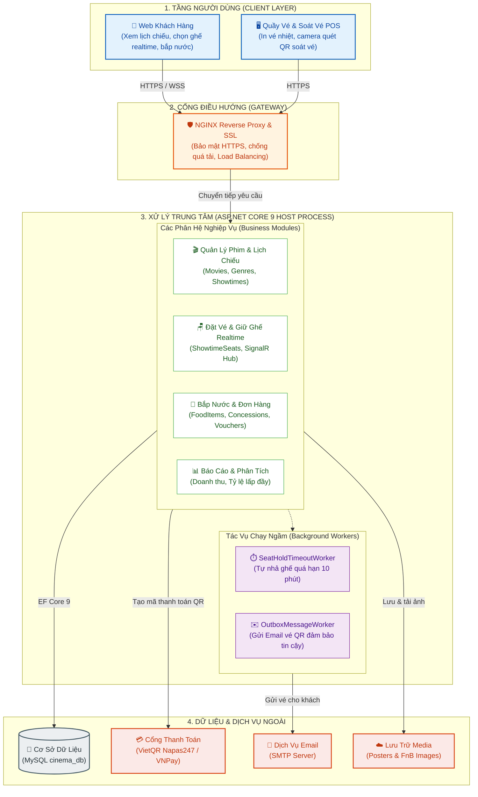

# 🎬 CineManagement - Hệ Thống Quản Lý & Đặt Vé Rạp Chiếu Phim

> **CineManagement** là hệ thống quản lý và bán vé rạp chiếu phim hiện đại xây dựng trên nền tảng **ASP.NET Core 9**, áp dụng kiến trúc **Modular Monolith**, tích hợp đồng bộ ghế theo thời gian thực (**SignalR WebSockets**), thanh toán tự động (**VietQR / VNPay**), xuất vé điện tử mã hóa QR và cơ chế chịu tải với **NGINX Reverse Proxy & Load Balancer**.

---

## 🏛️ Kiến Trúc Hệ Thống (System Architecture)

Hệ thống được thiết kế theo mô hình **Modular Monolith** kết hợp **Reverse Proxy Gateway**, chia làm 4 tầng độc lập:



---

## 📂 Sơ Đồ Cấu Trúc Thư Mục Dự Án (Directory Structure)

Toàn bộ cây thư mục dự án được tổ chức khoa học, phân định rõ ràng giữa hạ tầng chạy (**Docker / Nginx**), các script vận hành (**Scripts**) và mã nguồn backend (**CineManagement**):

```text
Cinema-Managment/
├── .gitignore                                # Cấu hình loại trừ file biên dịch và dữ liệu môi trường
├── CineManagement.slnx                       # Solution .NET mở dự án trên Visual Studio / IDE
├── README.md                                 # Tài liệu kiến trúc & cấu trúc dự án
│
└── CineManagement/                           # Thư mục mã nguồn chính ASP.NET Core 9 (Modular Monolith)
    ├── CineManagement.csproj                 # Cấu hình gói thư viện (NuGet: Pomelo MySQL, SignalR, QRCoder)
    ├── Program.cs                            # Entry point: Đăng ký DI, cấu hình Middleware Pipeline, SignalR Hub
    ├── appsettings.json                      # Cấu hình chuỗi kết nối Database, SMTP Server, JWT
    ├── appsettings.Development.json
    │
    ├── Modules/                              # Các phân hệ nghiệp vụ độc lập (Bounded Contexts)
    │   ├── Catalog/                          # Module Phim & Suất chiếu (Movies, Genres, Showtimes)
    │   │   ├── Domain/                       # Thực thể nghiệp vụ phim & suất chiếu
    │   │   └── Services/                     # Xử lý tính lịch chiếu, xung đột phòng chiếu
    │   ├── Cinemas/                          # Module Rạp & Phòng chiếu (Cinemas, Rooms, Seats)
    │   │   ├── Domain/                       # Cụm rạp, phòng chiếu, loại ghế
    │   │   ├── DTOs/                         # Data transfer objects sơ đồ ghế
    │   │   └── Services/                     # ISeatLayoutService, SeatLayoutService
    │   ├── Ticketing/                        # Module Đặt vé & Giữ ghế (ShowtimeSeats, Tickets, QR)
    │   │   ├── Domain/                       # Logic giữ ghế tạm thời, xuất vé điện tử
    │   │   └── Services/                     # Điều phối khóa ghế, giải mã vé check-in
    │   ├── Ordering/                         # Module Bắp nước (FoodItems, BookingConcessions)
    │   │   ├── Domain/                       # Danh mục món ăn, combo ưu đãi
    │   │   └── Services/                     # Tính tổng tiền bắp nước theo đơn
    │   ├── Payments/                         # Module Thanh toán (VietQR, Vouchers, Payments)
    │   │   └── Services/                     # Sinh mã thanh toán QR, áp dụng mã giảm giá
    │   └── Shared/                           # Thành phần hạ tầng dùng chung giữa các module
    │       ├── Common/                       # Kết quả trả về (Result pattern), DTOs dùng chung
    │       ├── Outbox/                       # Mô hình Transactional Outbox Pattern
    │       └── Storage/                      # Hợp đồng lưu trữ file ảnh (S3 / Local Storage)
    │
    ├── Controllers/                          # Tầng tiếp nhận HTTP Request (MVC Views & REST APIs)
    │   ├── AccountController.cs              # Đăng ký, đăng nhập tài khoản, đổi mật khẩu
    │   ├── AdminController.cs                # Bảng điều khiển quản trị viên, duyệt đơn, báo cáo
    │   ├── BookingController.cs              # Quy trình đặt vé khách hàng (Chọn ghế ➔ Bắp nước ➔ Thanh toán)
    │   ├── CinemaController.cs               # Quản lý danh sách cụm rạp
    │   ├── ScreeningRoomController.cs        # Quản lý phòng chiếu & giao diện thiết kế ma trận ghế
    │   ├── ShowtimeController.cs             # Lập lịch và quản lý ca chiếu phim
    │   ├── MovieController.cs                # Quản lý danh mục phim (thêm mới, chỉnh sửa, poster)
    │   ├── GenreController.cs                # Quản lý thể loại phim (Hành động, Kinh dị, Hoạt hình...)
    │   ├── FoodController.cs                 # Quản lý danh mục bắp nước & combo
    │   ├── CounterController.cs              # Giao diện bán vé trực tiếp tại quầy & In vé nhiệt
    │   ├── StaffController.cs                # Quản lý danh sách nhân viên rạp
    │   ├── HomeController.cs                 # Trang chủ khách hàng, chi tiết phim, điều khoản
    │   └── Api/                              # REST API Endpoints phục vụ Mobile App / SPA
    │       ├── BookingController.cs          # API giữ ghế, thanh toán đơn hàng
    │       ├── TicketsController.cs          # API quét mã QR soát vé trước cửa phòng chiếu
    │       ├── ReviewsController.cs          # API đánh giá và chấm điểm phim
    │       ├── ReportController.cs           # API xuất báo cáo số liệu doanh thu
    │       └── UserController.cs             # API lấy thông tin người dùng
    │
    ├── Hubs/                                 # Tầng Realtime WebSocket (ASP.NET Core SignalR)
    │   └── SeatBookingHub.cs                 # Kênh phát tín hiệu đồng bộ ghế tức thì giữa các client
    │
    ├── Services/                             # Tầng xử lý logic nghiệp vụ và Background Workers
    │   ├── BookingService.cs                 # Xử lý đơn hàng, giữ ghế, tính tổng hóa đơn
    │   ├── PaymentService.cs                 # Tích hợp cổng thanh toán VietQR / VNPay
    │   ├── EmailService.cs                   # Soạn thảo và gửi email hóa đơn vé điện tử kèm mã QR
    │   ├── QrCodeService.cs                  # Sinh ảnh mã QR vé xem phim và giải mã token bảo mật
    │   ├── ReportService.cs                  # Tổng hợp số liệu doanh thu và tỷ lệ lấp đầy phòng chiếu
    │   ├── FileStorageService.cs             # Quản lý lưu trữ poster phim và ảnh món ăn
    │   ├── SeatHoldTimeoutWorker.cs          # [Worker ngầm] Tự động nhả ghế giữ quá 10 phút chưa trả tiền
    │   └── OutboxMessageWorker.cs            # [Worker ngầm] Gửi email vé QR đảm bảo không mất mát
    │
    ├── Models/                               # Các thực thể dữ liệu ORM (Entity Framework Core)
    │   ├── ApplicationUser.cs                # Tài khoản khách hàng / nhân viên (ASP.NET Core Identity)
    │   ├── Staff.cs                          # Hồ sơ nhân viên, chi nhánh rạp trực thuộc
    │   ├── Cinema.cs                         # Thông tin cụm rạp (tên, địa chỉ, hotline)
    │   ├── ScreeningRoom.cs                  # Phòng chiếu phim
    │   ├── Seat.cs                           # Ghế gốc trong sơ đồ phòng
    │   ├── SeatType.cs                       # Định nghĩa loại ghế (Standard, VIP, Sweetbox đôi)
    │   ├── Movie.cs                          # Thông tin phim (tiêu đề, thời lượng, trailer, poster)
    │   ├── Genre.cs                          # Thể loại phim
    │   ├── Showtime.cs                       # Suất chiếu theo khung giờ tại phòng
    │   ├── ShowtimeSeat.cs                   # Trạng thái ghế riêng của từng suất chiếu (Trống/Đang giữ/Đã bán)
    │   ├── Booking.cs                        # Đơn đặt vé (Thông tin khách, tổng tiền, trạng thái)
    │   ├── Ticket.cs                         # Vé xem phim chính thức (Chứa QRCodeToken & thời gian check-in)
    │   ├── FoodItem.cs                       # Danh mục bắp, nước, snack
    │   ├── BookingConcession.cs              # Chi tiết số lượng bắp nước trong đơn
    │   ├── Payment.cs                        # Lịch sử giao dịch thanh toán
    │   ├── Voucher.cs                        # Mã giảm giá khuyến mãi
    │   ├── Review.cs                         # Đánh giá & nhận xét của khách hàng
    │   ├── OutboxMessage.cs                  # Bảng hàng đợi sự kiện Outbox (Transactional Outbox)
    │   └── Enums.cs                          # Bộ hằng số: SeatStatus, BookingStatus, PaymentStatus...
    │
    ├── Data/                                 # Tầng truy xuất cơ sở dữ liệu
    │   ├── ApplicationDbContext.cs           # DbContext chính, cấu hình khóa ngoại, indexes và quan hệ bảng
    │   └── SeedData.cs                       # Nạp dữ liệu khởi tạo mặc định (admin, rạp, phòng, phim)
    │
    ├── DTOs/                                 # Đối tượng truyền dữ liệu (Data Transfer Objects)
    ├── ViewModels/                           # Dữ liệu đóng gói cho các màn hình giao diện
    ├── Views/                                # Giao diện người dùng Razor Pages (.cshtml)
    │   ├── Home/                             # Màn hình trang chủ & Chi tiết phim
    │   ├── Booking/                          # Chọn ghế realtime, chọn bắp nước, thanh toán VietQR
    │   ├── Counter/                          # Màn hình nhân viên quầy vé & in vé nhiệt
    │   ├── Admin/                            # Bảng điều khiển quản trị, doanh thu, quét vé QR
    │   ├── Movie/, Showtime/, Cinema/...     # Các màn hình CRUD quản lý danh mục
    │   └── Shared/                           # Layout dùng chung (_Layout.cshtml, _AdminLayout.cshtml)
    │
    └── wwwroot/                              # Tài nguyên tĩnh công khai (CSS, JS, Posters, FnB images)
```

---

## 🚀 Các Tính Năng Nổi Bật Của Hệ Thống

1. **Khóa ghế thời gian thực (Real-time Seat Locking):**
   - Khi một khách hàng bấm chọn ghế, tín hiệu được gửi qua `SeatBookingHub (SignalR)` tới tất cả người dùng khác đang mở phòng chiếu đó để chuyển ghế sang màu vàng (đang có người chọn), triệt tiêu hoàn toàn lỗi 2 người đặt trùng 1 ghế (**Race Condition**).
2. **Bộ đếm giải phóng ghế tự động (`SeatHoldTimeoutWorker`):**
   - Ghế được giữ tối đa trong 10 phút. Nếu quá thời gian khách không thanh toán, tiến trình ngầm sẽ tự động hoàn trả ghế về trạng thái trống (`Available`) và đồng bộ lại giao diện.
3. **Thanh toán VietQR Napas247 động:**
   - Tự động sinh mã VietQR Quick Link chứa số tiền chính xác và mã đơn hàng. Khi thanh toán thành công, hệ thống tự động xác nhận qua IPN/Webhook.
4. **Vé điện tử mã hóa QR & Soát vé bằng Camera:**
   - Mỗi vé xuất ra được mã hóa bằng token bảo mật. Nhân viên tại rạp có thể dùng trực tiếp camera điện thoại hoặc máy quét để check-in khách vào phòng chiếu.
5. **Gửi vé qua Email đảm bảo không thất lạc (`Transactional Outbox Pattern`):**
   - Sự kiện xuất vé được lưu vào cùng một transaction với thanh toán, tiến trình `OutboxMessageWorker` đảm bảo vé và mã QR luôn được gửi đến hòm thư khách hàng ngay cả khi mạng chập chờn.
6. **Hạ tầng NGINX chịu tải cao:**
   - NGINX đóng vai trò Reverse Proxy, cân bằng tải (Upstream Load Balancing) giữa nhiều backend node, xử lý SSL Termination và cache file tĩnh.

---

## 🛠️ Công Nghệ Sử Dụng

- **Backend:** C# .NET 9 (ASP.NET Core MVC & Web API)
- **Real-time:** ASP.NET Core SignalR (WebSockets)
- **Cơ sở dữ liệu:** MySQL 8.0 / MariaDB qua Pomelo Entity Framework Core 9
- **Reverse Proxy & Gateway:** NGINX 1.27
- **Bảo mật & Xác thực:** ASP.NET Core Identity & QR Token Cryptography
- **Containerization:** Docker & Docker Compose
- **Front-end:** Razor Views, JavaScript ES6, Tailwind CSS & HTML5 QR Scanner
