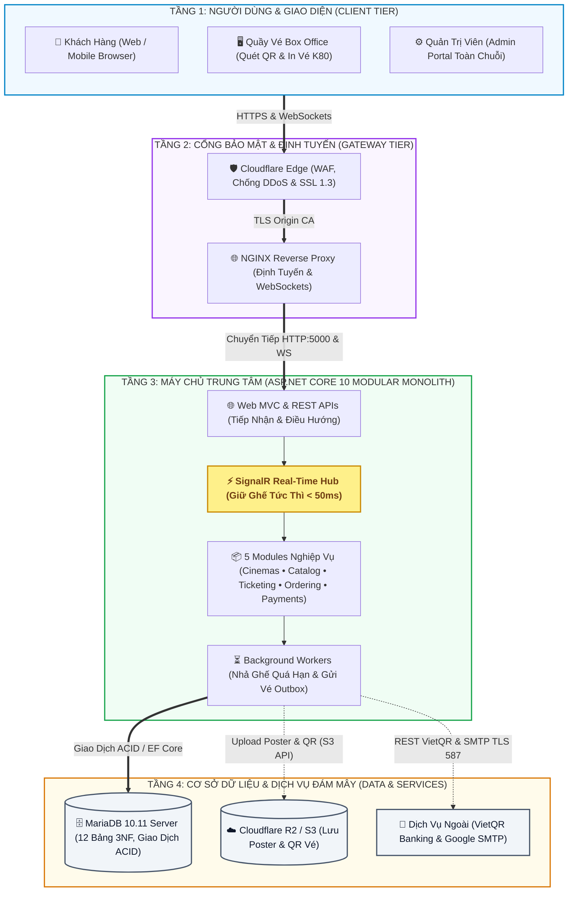
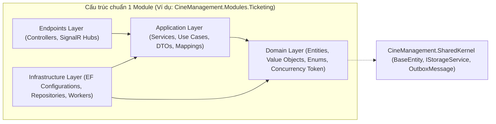
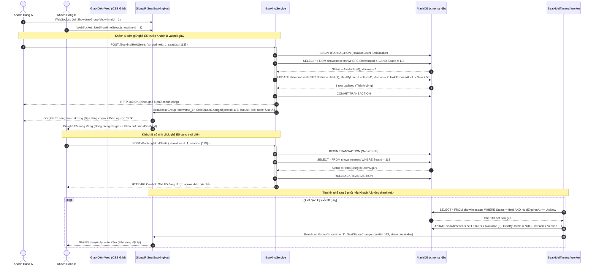
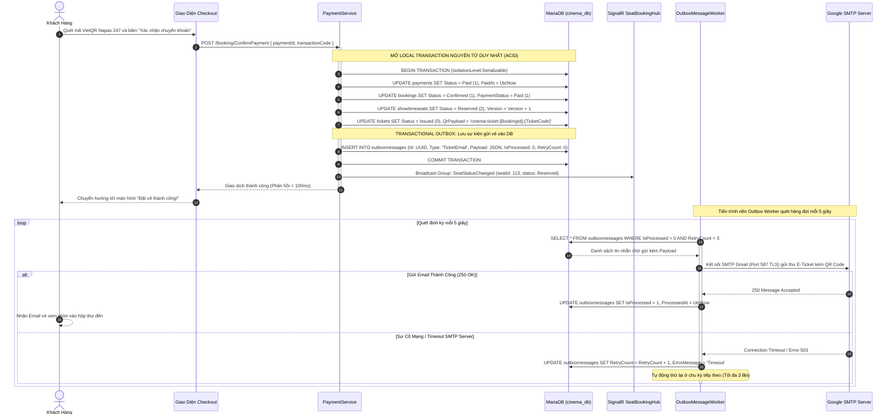
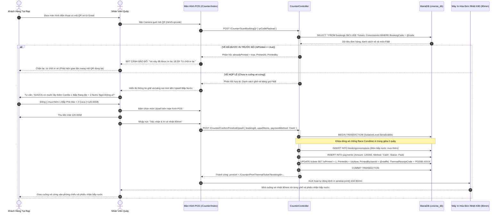
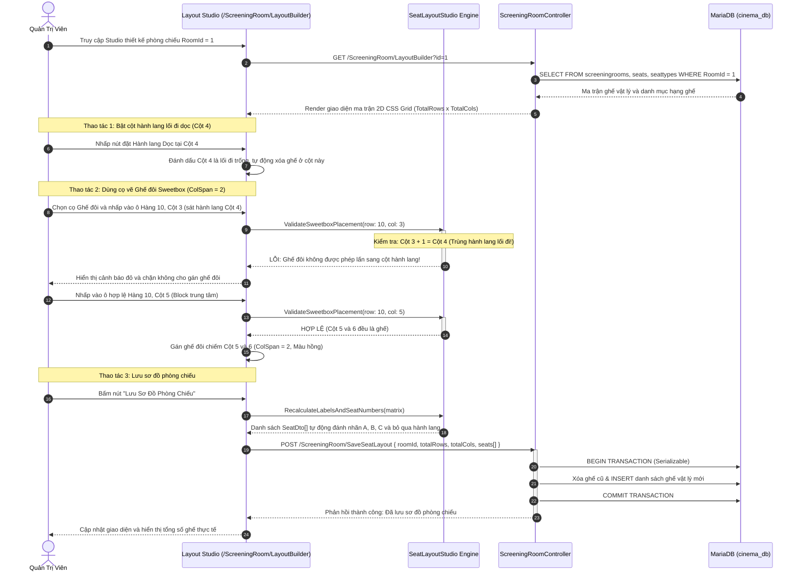
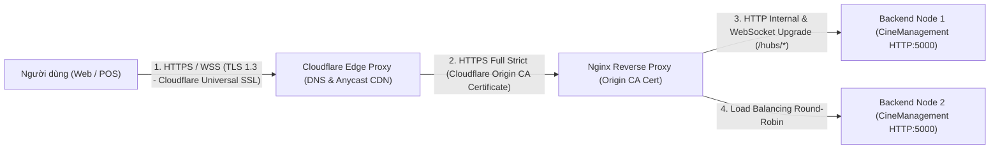
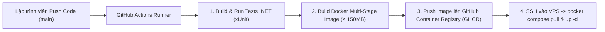

# THIẾT KẾ KIẾN TRÚC HỆ THỐNG (SYSTEM ARCHITECTURE DESIGN)

> **Đề tài**: Hệ thống Quản trị Tập trung Chuỗi Rạp Chiếu Phim (CineManagement)  
> **Tiêu chuẩn áp dụng**: Chuẩn đầu ra **CLO1 & CLO2** – Kiến trúc Modular Monolith, Docker Compose, Cloudflare R2/SSL, SignalR Real-Time, Dual-Concurrency Control & Transactional Outbox  
> **Tài liệu liên quan**: [`01_PRODUCT_BACKLOG.md`](./01_PRODUCT_BACKLOG.md), [`02_YEU_CAU_HE_THONG.md`](./02_YEU_CAU_HE_THONG.md), [`03_SO_DO_PHAN_RA_CHUC_NANG.md`](./03_SO_DO_PHAN_RA_CHUC_NANG.md), [`05_THIET_KE_CO_SO_DU_LIEU.md`](./05_THIET_KE_CO_SO_DU_LIEU.md)

---

## 1. TỔNG QUAN KIẾN TRÚC HỆ THỐNG

Hệ thống **CineManagement** được thiết kế theo mô hình **Modular Monolith chuẩn doanh nghiệp kết hợp Real-time WebSockets Gateway và Asynchronous Background Workers**, đảm bảo khả năng mở rộng linh hoạt cho toàn chuỗi rạp đa chi nhánh:

1. **Core Backend (`CineManagement` - C# .NET 10)**:
   - Áp dụng kiến trúc **Modular Monolith**: Toàn bộ nghiệp vụ quản trị cụm rạp, phòng chiếu, danh mục phim, suất chiếu, đặt vé, quầy POS và thanh toán được chia thành các module nghiệp vụ độc lập (`Cinemas`, `Catalog`, `Ticketing`, `Ordering`, `Payments`), chạy chung trong một tiến trình `.NET` hiệu năng cao.
   - Giữ ranh giới miền (*Domain Boundaries*) chặt chẽ, giao tiếp nội bộ thông qua Service Contracts, DTOs và In-process Events, sẵn sàng tách thành Microservices độc lập trong tương lai mà không làm vỡ kiến trúc.
2. **Cổng Thời Gian Thực Siêu Tốc (`SignalR SeatBookingHub`)**:
   - Sử dụng **ASP.NET Core SignalR Core** duy trì kết nối song công (Full-Duplex WebSockets) với độ trễ $< 50\text{ ms}$.
   - Phân nhóm kết nối theo từng suất chiếu (`showtime_{id}`), tự động đồng bộ hóa trạng thái ghế (`Available -> Held -> Reserved`) tức thì giữa hàng trăm người dùng đang cùng mở sơ đồ phòng chiếu mà không cần tải lại trang.
3. **Phân Hệ Quầy Vé POS "Một Cửa" (Box Office POS Console)**:
   - Giao diện chuyên biệt cho nhân viên rạp (`/Counter`), tích hợp camera quét mã QR vé (`html5-qrcode`), cờ kiểm soát chống in vé lậu lần 2 (`IsPrinted Guard`), máy tính bán kèm bắp nước nhanh (Upsell F&B) và trình xuất cuộn vé nhiệt K80 80mm rời từng ghế theo giao thức ESC/POS.
4. **Hạ Tầng Lưu Trữ & Đám Mây Phân Tán**:
   - **MariaDB 10.11 Server (InnoDB)**: Lưu trữ dữ liệu giao dịch 12 bảng chuẩn hóa 3NF, bảo đảm tính toàn vẹn $ACID$ với mức cô lập `IsolationLevel.Serializable`.
   - **Cloudflare R2 Storage (Tương thích S3 API)**: Lưu trữ đám mây không tốn phí băng thông tải ra (Zero Egress Fees) cho toàn bộ ảnh Poster phim độ phân giải cao và ảnh mã QR vé điện tử.
   - **Cloudflare DNS & Full (Strict) SSL**: Bảo vệ máy chủ VPS đằng sau lớp lá chắn WAF/DDoS, mã hóa toàn bộ lưu lượng bằng chứng chỉ Cloudflare Origin CA.

---

## 2. SƠ ĐỒ KIẾN TRÚC TỔNG THỂ (HIGH-LEVEL ARCHITECTURE DIAGRAM)

Sơ đồ được thiết kế theo mô hình **phân tầng dọc (Vertical Layered Architecture)** chuẩn doanh nghiệp, sắp xếp các khối thành hàng dọc gọn gàng, luồng dữ liệu truyền thẳng từ trên xuống dưới:

### 2.1. Bảng Đặc Tả Vai Trò Của Từng Thành Phần Trong Hệ Thống

| Tầng kiến trúc | Thành phần | Vai trò kỹ thuật & Trách nhiệm nghiệp vụ |
| :--- | :--- | :--- |
| **Tầng 1: Clients** | **👤 Khách Hàng (Customer)** | Trình duyệt Web/Mobile cho phép người dùng xem phim, lịch chiếu, chọn ghế trực quan trên sơ đồ 2D thời gian thực (CSS Grid), đặt vé và quét mã VietQR chuyển khoản. Duy trì WebSocket với SignalR để nhận cập nhật ghế tức thì ($< 50\text{ ms}$). |
| | **🖥️ Quầy Vé Box Office (Staff POS)** | Giao diện "một cửa" `/Counter` cho nhân viên rạp: Dùng camera (`html5-qrcode`) quét mã QR vé điện tử của khách, kích hoạt cờ chống in vé lậu (`IsPrinted Guard`), Upsell bắp nước và in vé nhiệt rời từng ghế khổ K80 80mm qua giao thức ESC/POS. |
| | **⚙️ Quản Trị Viên (Admin Portal)** | Giao diện dành riêng cho Admin quản lý toàn bộ chuỗi rạp: Cụm rạp chi nhánh (`Cinemas`), phòng chiếu (`ScreeningRooms`), sơ đồ ghế 2D (Visual Seat Studio với quy tắc Aisle Guard), danh mục phim (`Movies`), lập lịch suất chiếu (`Showtimes`) và báo cáo doanh thu. |
| **Tầng 2: Gateway** | **🛡️ Cloudflare Edge** | Tuyến phòng ngự biên: Ẩn IP máy chủ gốc, lọc tấn công DDoS (L3/L4/L7), WAF chặn bot độc hại, mã hóa SSL/TLS 1.3 tới người dùng, và CDN cache tài nguyên tĩnh/poster. Giao tiếp với VPS thông qua chứng chỉ nội bộ **Cloudflare Origin CA Certificate**. |
| | **🌐 NGINX Reverse Proxy** | Cổng tiếp nhận duy nhất trên VPS: Điều hướng lưu lượng vào container backend qua mạng Docker; xử lý nén (Gzip/Brotli) và cấu hình **WebSocket Upgrade Headers** (`Upgrade $http_upgrade; Connection "upgrade";`) để duy trì kênh song công ổn định cho SignalR. |
| **Tầng 3: Backend** | **🌐 Web MVC & REST APIs** | Điểm tiếp nhận request từ Client: Xác thực người dùng (Identity & Cookie Auth), phân quyền 3 Actor (RBAC), kiểm tra tính hợp lệ của dữ liệu (Validation) và điều hướng đến các Module nghiệp vụ tương ứng. |
| | **⚡ SignalR Real-Time Hub** | "Trái tim" thời gian thực của hệ thống: Phân nhóm kết nối theo từng suất chiếu (`showtime_{id}`). Phát sóng sự kiện `SeatStatusChanged` tức thì ($< 50\text{ ms}$) tới toàn bộ client trong nhóm ngay khi có ghế được giữ/nhả/thanh toán, ngăn chặn xung đột giữ ghế ngay tại giao diện. |
| | **📦 5 Bounded Modules** | Cốt lõi nghiệp vụ theo chuẩn **Modular Monolith**:  • `Cinemas`: Quản trị rạp, phòng chiếu, sơ đồ ghế 2D, quy tắc Sweetbox Aisle Guard. • `Catalog`: Quản lý danh mục phim, độ tuổi, định dạng, lập lịch suất chiếu. • `Ticketing`: Quản lý `ShowtimeSeats`, kiểm soát tương tranh bằng `Version Concurrency Token`. • `Ordering`: Quản lý đơn `Bookings`, sinh vé `Tickets`, bán F&B và xử lý POS `/Counter`. • `Payments`: Xử lý thanh toán VietQR với `IsolationLevel.Serializable` và Transactional Outbox. |
| | **⏳ Background Workers** | Hai tiến trình nền chạy ngầm độc lập: • `SeatHoldTimeoutWorker`: Định kỳ quét mỗi 30s để tự động giải phóng ghế `Held` đã quá hạn 5 phút về `Available`, bắn tín hiệu SignalR nhả ghế. • `OutboxMessageWorker`: Thực thi Transactional Outbox Pattern, định kỳ quét bảng `outboxmessages` mỗi 5s để gửi email vé điện tử kèm mã QR qua Google SMTP với cơ chế Retry 3 lần (*At-Least-Once Delivery*). |
| **Tầng 4: Data & Cloud** | **🗄️ MariaDB 10.11 Server** | Cơ sở dữ liệu quan hệ nguồn (Source of Truth): Lưu trữ 12 bảng chuẩn hóa 3NF, bảo đảm tính toàn vẹn giao dịch $ACID$ với Storage Engine InnoDB. |
| | **☁️ Cloudflare R2 / S3** | Hạ tầng lưu trữ đám mây chuẩn S3 API (Zero Egress Fees): Lưu trữ an toàn Poster phim độ phân giải cao và toàn bộ ảnh mã QR vé điện tử, giải phóng máy chủ web khỏi lưu file cục bộ, hỗ trợ mở rộng scale-out dễ dàng. |
| | **🔌 Dịch Vụ Ngoài (External)** | • **VietQR Napas 247**: Sinh mã QR thanh toán động kèm số tài khoản và cú pháp chuyển khoản đơn hàng. • **Google SMTP Server**: Cổng gửi email vé điện tử tự động qua cổng 587 bảo mật TLS. |

---

## 3. KIẾN TRÚC NỘI BỘ BACKEND C# .NET (MODULAR MONOLITH)

Mỗi module nghiệp vụ trong hệ thống tuân thủ chặt chẽ kiến trúc **Clean Architecture** gồm 4 phân tầng độc lập:

### Nguyên tắc giao tiếp giữa các Module:
1. **Cô lập dữ liệu (Database Isolation)**: Mỗi module quản lý tập thực thể (Entities) của riêng mình. Không có module nào được phép trực tiếp sửa đổi `DbSet` nội bộ của module khác mà phải thông qua Interface hợp đồng công khai.
2. **Kiểm soát tương tranh kép (Dual-Concurrency Engine)**:
   * **Pessimistic Locking**: Mọi giao dịch giữ ghế, thanh toán và in vé quầy POS đều mở Database Transaction ở mức `IsolationLevel.Serializable`.
   * **Optimistic Concurrency**: Thuộc tính `[ConcurrencyCheck] public int Version` trên `ShowtimeSeat` tự động tăng sau mỗi thao tác, ngăn chặn tuyệt đối tình trạng bán trùng vé (Double Booking).
3. **Truyền thông tin cậy qua Transactional Outbox Pattern**:
   * Khi thanh toán thành công, sự kiện `TicketEmail` được ghi vào bảng `outboxmessages` trong cùng một Local Transaction của đơn hàng ($ACID$). Tiến trình nền `OutboxMessageWorker` quét ngầm mỗi 5 giây, bảo đảm nguyên lý *At-Least-Once Delivery* kể cả khi mất mạng.

---

## 4. SƠ ĐỒ TUẦN TỰ CÁC LUỒNG NGHIỆP VỤ TRỌNG TÂM (SEQUENCE DIAGRAMS)

### 4.1. Luồng 1: Đặt & Giữ Ghế Real-Time (SignalR WebSockets & Dual-Concurrency)

Quy trình giữ ghế tạm thời trong 5 phút, khóa ghế hai tầng chống Race Condition và đồng bộ tức thì cho tất cả khán giả qua SignalR:

---

### 4.2. Luồng 2: Xác Nhận Thanh Toán VietQR & Transactional Outbox Pattern

Quy trình thanh toán chuyển khoản Napas 247, khóa vé vĩnh viễn và gửi email E-Ticket kèm mã QR cá nhân hóa không nghẽn luồng:

---

### 4.3. Luồng 3: Quầy Vé Box Office POS (Quét QR + IsPrinted Guard + Upsell F&B + In Nhiệt K80)

Quy trình phục vụ "Một Cửa" của nhân viên thu ngân tại rạp:

---

### 4.4. Luồng 4: Thiết Kế Sơ Đồ Phòng Chiếu (Visual Seat Studio & Thuật Toán Aisle Guard)

Quy trình quản trị viên cấu hình ma trận ghế 2D, tùy biến lối đi hành lang và kiểm tra an toàn ghế đôi Sweetbox:

---

## 5. THIẾT KẾ TRIỂN KHAI HẠ TẦNG, MẠNG & CI/CD (DEPLOYMENT VIEW)

### 5.1. Mô Hình Bảo Mật SSL/TLS qua Cloudflare và Nginx VPS

### 5.2. Quy Trình Tự Động Hóa CI/CD (GitHub Actions Workflow)

---

## 6. BẢNG TỔNG HỢP CÔNG NGHỆ SỬ DỤNG TRONG HỆ THỐNG

| Tầng kiến trúc | Thành phần kỹ thuật | Phiên bản / Công nghệ | Lý do lựa chọn cho Đồ án (Đáp ứng CLO1 & CLO2) |
| :--- | :--- | :--- | :--- |
| **Backend Core** | Framework & Runtime | **C# .NET 10 (ASP.NET Core Web)** | Hiệu năng xử lý cao, hỗ trợ hoàn hảo mô hình Modular Monolith, quản lý phụ thuộc DI rõ ràng, kiểm soát kiểu dữ liệu tĩnh nghiêm ngặt. |
| **Real-time WebSockets** | Giao thức thời gian thực | **ASP.NET Core SignalR Core** | Duy trì kết nối song công hai chiều, đồng bộ trạng thái ghế tức thì $< 50\text{ ms}$, tự động phục hồi kết nối (`withAutomaticReconnect`). |
| **Kiểm soát tương tranh** | Concurrency Engine | **Serializable + Optimistic Concurrency Token** | Khóa mức `Serializable` kết hợp `[ConcurrencyCheck] public int Version` ngăn chặn 100% tình trạng double-booking khi mở bán phim bom tấn. |
| **Giao dịch tin cậy** | Resilient Messaging | **Transactional Outbox Pattern** | Đảm bảo nguyên tử ($ACID$), cam kết *At-Least-Once Delivery* gửi email vé E-Ticket kèm mã QR cá nhân hóa không phụ thuộc vào trạng thái mạng SMTP. |
| **Database** | Cơ sở dữ liệu quan hệ | **MariaDB 10.11 InnoDB (cinema_db)** | Hệ quản trị CSDL chuẩn hóa 12 bảng 3NF, hỗ trợ giao dịch ACID, Foreign Key constraints và kết nối qua connection pooling tốc độ cao. |
| **Frontend UI** | Giao diện Web Khách hàng | **Razor Pages + Bootstrap 5 + CSS Grid Matrix** | Render ma trận sơ đồ ghế 2D sắc nét, tự co giãn Responsive trên thiết bị di động, tích hợp modal thanh toán VietQR Napas 247. |
| **Quầy vé POS** | Quầy vé Một Cửa & In K80 | **html5-qrcode + ESC/POS K80 Thermal Print** | Quét mã QR vé trực tiếp qua camera thiết bị, kiểm tra cờ `IsPrinted Guard`, gợi ý Upsell F&B và in phiếu nhiệt 80mm rời từng ghế. |
| **Object Storage** | Lưu trữ đám mây đối tượng | **Cloudflare R2 (AWSSDK.S3 API) / MinIO** | Tách rời tệp tĩnh, không tốn chi phí băng thông tải ra (Zero Egress Fee), giúp backend hoàn toàn phi trạng thái (Stateless). |
| **Cloud & DevOps** | Đóng gói & Triển khai an toàn | **Docker Compose + Nginx + Cloudflare + GitHub Actions** | Tự động hóa build test và đóng gói image lên GHCR, bảo vệ máy chủ VPS bằng chứng chỉ Cloudflare Origin CA và Edge WAF. |
