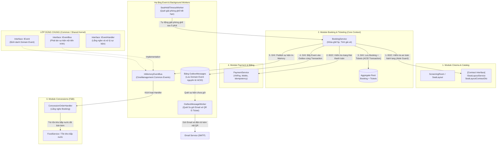
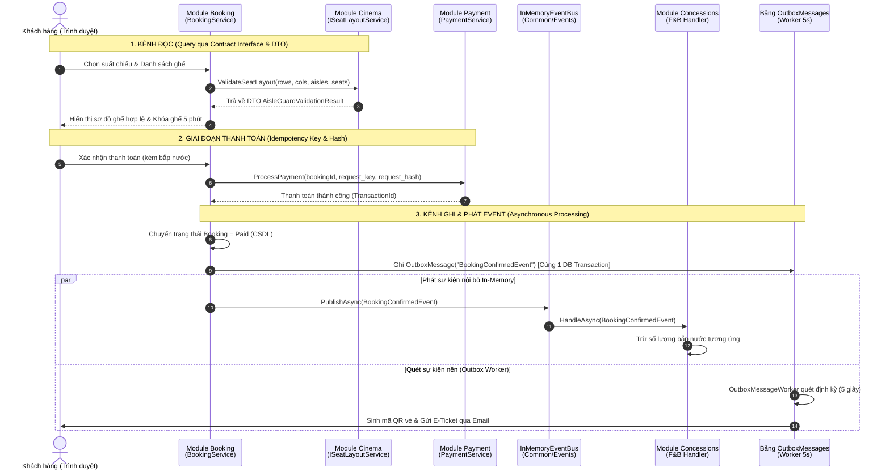

# TÀI LIỆU KIẾN TRÚC MODULAR MONOLITH & GIAO TIẾP LIÊN MODULE
## HỆ THỐNG QUẢN LÝ CHUỖI RẠP CHIẾU PHIM TẬP TRUNG (CINEMANAGEMENT)

> **Mục tiêu**: Chuẩn hóa kiến trúc hệ thống theo mô hình **Modular Monolith** kết hợp **Domain-Driven Design (DDD)**, giải quyết triệt để các vấn đề:
> - Giới hạn ranh giới nghiệp vụ rõ ràng (**Bounded Contexts**).
> - Tách biệt độc lập giữa **Kênh ĐỌC (Query qua Contract Interface & DTO)** và **Kênh GHI (Command/Event qua In-Memory Event Bus & Transactional Outbox)**.
> - Cung cấp minh chứng kiểm thử tự động (**Unit Test Cases**) cho các ràng buộc nghiệp vụ then chốt.

---

## 1. TẠI SAO LẠI CHIA DOMAIN NHƯ VẬY? (XÁC ĐỊNH BOUNDED CONTEXT)

Trong một hệ thống chuỗi rạp chiếu phim quy mô lớn, nếu dồn toàn bộ thực thể vào một Database Context hoặc kiến trúc MVC nguyên khối truyền thống, các miền nghiệp vụ sẽ bị chồng chéo (Tight Coupling) và mô hình thực thể bị phình to (Bloated Models). 

Để đảm bảo tính độc lập và khả năng mở rộng (Maintainability & Scalability), hệ thống CineManagement được phân chia thành **5 Bounded Contexts** dựa trên ngôn ngữ chung (**Ubiquitous Language**) và vòng đời dữ liệu riêng biệt:

| STT | Bounded Context (Module) | Trách Nhiệm Nghiệp Vụ (Single Responsibility) | Aggregate Root & Entities | Khái Niệm Ngữ Cảnh Riêng Biệt (Ubiquitous Language) |
| :---: | :--- | :--- | :--- | :--- |
| **01** | **Cinema & Catalog** | Quản lý hạ tầng rạp vật lý, ma trận phòng chiếu, thuật toán an toàn hành lang (Aisle Guard) và danh mục phim chiếu. | `Cinema`, `ScreeningRoom`, `Seat`, `SeatType`, `Movie`, `Genre`, `Showtime` | **`Seat`**: Là vị trí vật lý cố định trong phòng chiếu (Hàng A, Cột 5, Ghế VIP/Sweetbox). Không lưu vết ai đang ngồi. |
| **02** | **Booking & Ticketing** | Quản lý vòng đời chọn ghế, khóa giữ chỗ 5 phút, tính toán tổng tiền vé và phát hành vé điện tử E-Ticket. | **Aggregate Root: `Booking`**, `ShowtimeSeat`, `Ticket` | **`ShowtimeSeat`**: Là trạng thái động của ghế theo suất chiếu (Trống, Đang giữ tạm, Đã bán). **`Ticket`**: Thực thể chứa mã vé QR và trạng thái in vé nhiệt. |
| **03** | **Concessions (F&B)** | Quản lý bán bắp nước, combo ăn uống kèm theo vé trực tuyến hoặc bán trực tiếp tại quầy POS. | `FoodItem`, `BookingConcession` | **`BookingConcession`**: Đóng băng đơn giá bắp nước tại thời điểm mua (`PriceAtPurchase`) để hóa đơn lịch sử không bị sai lệch khi menu tăng giá. |
| **04** | **Payment & Billing** | Tích hợp cổng thanh toán trực tuyến (VNPay/MoMo/Tiền mặt), kiểm tra tính bất biến **Idempotency** (`request_key`, `request_hash`) và voucher giảm giá. | `Payment`, `Voucher` | **`IdempotencyKey`**: Khóa chống thanh toán trùng lặp khi mạng lag bấm 2 lần liên tiếp. |
| **05** | **Operations & Counter** | Quầy vé POS "Một Cửa" cho nhân viên rạp: quét mã QR vé (`ScanBookingQr`), bán vé cho khách vãng lai, in vé nhiệt K80 và báo cáo doanh thu. | `Staff`, `ReportService` | **`ScanBookingQr`**: Thao tác xác thực vé một chạm, chống gian lận tái sử dụng vé (`IsPrinted Guard`). |

---

## 2. SƠ ĐỒ MÔ HÌNH HÓA GIAO TIẾP GIỮA CÁC MODULE

Các module trong CineManagement **tuyệt đối không truy cập trực tiếp vào DbContext hoặc bảng CSDL nội bộ của nhau**. Thay vào đó, sự tương tác được chuẩn hóa qua **2 kênh giao tiếp rõ ràng**:



---

## 3. CƠ CHẾ GIAO TIẾP ĐỌC (READ / QUERY FLOW)

> **Giải quyết thắc mắc của Giảng viên**: *"Mới có publish event để ghi, thế trường hợp ĐỌC dữ liệu giữa các module thì thực hiện như thế nào?"*

Khi một Module (ví dụ: `Booking`) cần lấy dữ liệu từ Module khác (ví dụ: `Cinema & Catalog`), nó **không được include navigation property xuyên domain**. Thay vào đó, nó giao tiếp qua **Public Contract Interface** và **Immutable DTO (Read Models)**:

1. **Vị trí Contract**: Được định nghĩa tại `Modules/Cinemas/Services/ISeatLayoutService.cs`.
2. **DTO truyền nhận**: `SeatLayoutItem`, `AisleGuardValidationResult`.
3. **Mã nguồn thực tế trong CineManagement**:
```csharp
// Trong Controller/Service của Module Booking:
// Chỉ gọi thông qua Interface Contract và nhận về DTO độc lập
var validationResult = _seatLayoutService.ValidateSeatLayout(
    screeningRoom.TotalRows,
    screeningRoom.TotalColumns,
    screeningRoom.AisleRows,
    screeningRoom.AisleCols,
    selectedSeats);

if (!validationResult.IsValid)
{
    return BadRequest(new { code = validationResult.ErrorCode, message = validationResult.ErrorMessage });
}
```
**Lợi ích**: Module `Cinema` có thể thay đổi cấu trúc bảng CSDL nội bộ hoặc thuật toán tối ưu hóa mà không làm gãy vỡ mã nguồn của Module `Booking`.

---

## 4. CƠ CHẾ GIAO TIẾP GHI (WRITE / EVENT-DRIVEN FLOW)

> **Giải quyết thắc mắc của Giảng viên**: *"Interface của phần phát event được tạo từ đâu? Phát event xong bên nhận xử lý thế nào?"*

### 4.1. Vị trí Interface Phát Event
Toàn bộ Interface phát tán sự kiện được định nghĩa tại **Shared Kernel** (`CineManagement.Common.Events`):
* `IEvent`: Định danh Domain Event (`EventId`, `OccurredOn`).
* `IEventBus`: Phương thức phát tán `Task PublishAsync<TEvent>(TEvent @event)`.
* `IEventHandler<TEvent>`: Phương thức tiếp nhận `Task HandleAsync(TEvent @event)`.

### 4.2. Hai cấp độ phát tán sự kiện trong CineManagement
1. **Cấp độ Trong tiến trình (In-Memory Event Bus)**:
   * Được triển khai qua class `InMemoryEventBus.cs` đăng ký Singleton trong ASP.NET Core DI Container.
   * Khi `Booking` thanh toán thành công, `BookingConfirmedEvent` được bắn ra để Module `Concessions` cập nhật số lượng bắp nước tức thì mà không cần gọi chéo Service.
2. **Cấp độ Bền vững (Transactional Outbox Pattern)**:
   * Nhằm giải quyết bài toán: *Nếu gửi Email vé QR hoặc gọi API bên thứ ba bị mất mạng thì giao dịch có bị mất không?*
   * Giải pháp: Sự kiện được ghi trực tiếp vào bảng CSDL `OutboxMessages` **trong cùng một Database Transaction với đơn đặt vé (ACID)**.
   * Tiến trình nền `OutboxMessageWorker.cs` quét định kỳ mỗi 5 giây để gửi Email vé QR với cơ chế Retry an toàn tối đa 3 lần.

---

## 5. SƠ ĐỒ TUẦN TỰ (SEQUENCE DIAGRAM) TOÀN BỘ VÒNG ĐỜI GIAO DỊCH



---

## 6. MINH CHỨNG KIỂM THỬ TỰ ĐỘNG (UNIT TEST VERIFICATION)

Để đáp ứng tiêu chuẩn khắt khe: *"Các yêu cầu ràng buộc, yc chức năng, phi chức năng phải có kiểm chứng bằng test case"*, toàn bộ các quy tắc liên module đã được kiểm thử tự động trong dự án `tests/CineManagement.Tests`:

* **`AisleGuardSeatLayoutTests.cs`**:
  * `ValidateSeatLayout_WhenLayoutIsValid_ShouldReturnSuccess`: Xác minh sơ đồ ghế và hành lang hợp lệ.
  * `ValidateSeatLayout_WhenSweetboxOverlapsAisleColumn_ShouldFailWithAisleGuardViolation`: Kiểm chứng thuật toán chặn ghế đôi Sweetbox (`ColSpan=2`) đè lên cột hành lang dọc.
  * `ValidateSeatLayout_WhenSeatPlacedOnAisleRow_ShouldFailWithAisleRowCollision`: Kiểm chứng chặn đặt ghế trên hàng hành lang ngang.
  * `ValidateSeatLayout_WhenTwoSeatsDuplicateCoordinate_ShouldFail`: Kiểm chứng chặn trùng tọa độ ghế.
* **`NonFunctionalConstraintTests.cs`**:
  * `SeatHoldTimeout_ShouldExpireAfterExactFiveMinutes`: Chứng minh quy tắc khóa ghế 5 phút (4p59s hợp lệ, 5p01s tự động giải phóng).
  * `IdempotencyKey_SameRequestMustProduceIdenticalHash`: Kiểm chứng cơ chế `request_key` / `request_hash` chống trừ tiền hai lần khi mạng chập chờn.
  * `StorageService_OnlyWhitelistedImageExtensionsAllowed`: Kiểm chứng ràng buộc bảo mật tải ảnh lên Cloudflare R2.

> **Kết quả thực thi kiểm thử**:
> ```
> Passed!  - Failed: 0, Passed: 14, Skipped: 0, Total: 14 - Duration: 303 ms
> ```

---

## 7. CẤU TRÚC THƯ MỤC TRIỂN KHAI TRONG CODEBASE

```
CineManagement/
├── Common/
│   └── Events/
│       ├── IEvent.cs               # Interface định danh Domain Event
│       ├── IEventBus.cs            # Interface trung tâm của Event Publisher
│       └── InMemoryEventBus.cs     # Triển khai In-Memory Event Bus nội tiến trình
├── Modules/
│   └── Cinemas/
│       └── Services/
│           ├── ISeatLayoutService.cs       # Contract Interface phục vụ Kênh ĐỌC
│           └── SeatLayoutService.cs        # Triển khai thuật toán Aisle Guard
├── Controllers/
│   ├── BookingController.cs        # Quản lý quy trình đặt vé và giao tiếp liên module
│   ├── CounterController.cs        # Nghiệp vụ POS quầy vé, soát QR, in vé nhiệt
│   └── ScreeningRoomController.cs  # Thiết kế phòng chiếu và phân định hành lang
├── Services/
│   ├── OutboxMessageWorker.cs      # Background Service xử lý Transactional Outbox
│   ├── SeatHoldTimeoutWorker.cs    # Background Service giải phóng ghế sau 5 phút
│   └── S3StorageService.cs         # Lưu trữ ảnh đám mây Cloudflare R2 (S3 API)
└── tests/
    └── CineManagement.Tests/       # Bộ kiểm thử tự động xUnit (14 test cases Passed)
```
